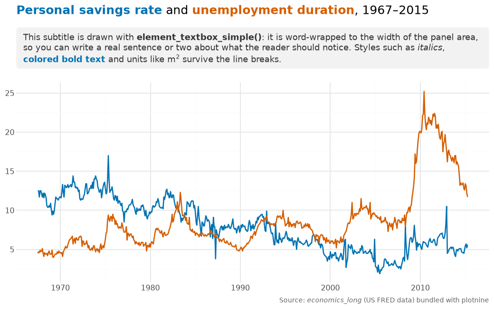
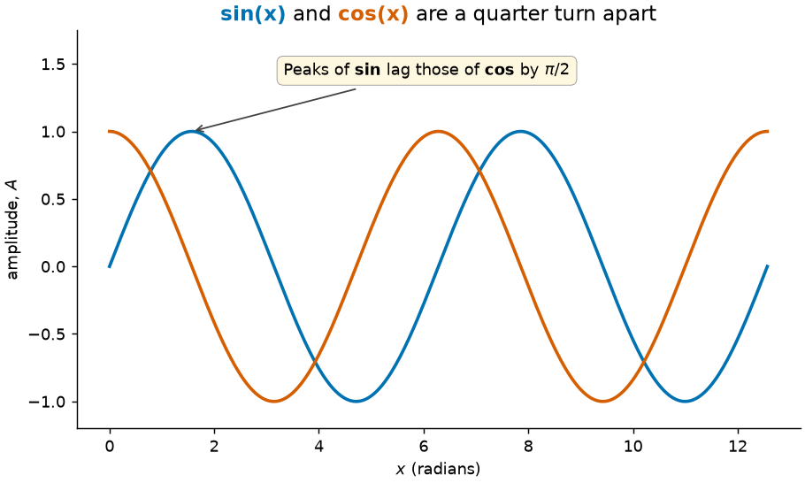

# ggtext

[](https://github.com/snake-case-ggtext/ggtext_ShanEllis/actions/workflows/tests.yml)

**Rich text for matplotlib and plotnine.** You can use Markdown, HTML, and inline CSS anywhere text appears in a plot: titles, subtitles, captions, axis titles, tick labels, facet strips, legends, and labels placed in the data.

This is a Python take on the R package [ggtext](https://wilkelab.org/ggtext/) by Claus Wilke. It is built for the Python/SciPy community. The core works with plain matplotlib, and plotnine support is an optional extra on top.


## Is ggtext-style text possible in plotnine? Yes.

[plotnine issue #612](https://github.com/has2k1/plotnine/issues/612) asked for ggtext-style rich text. The answer was that matplotlib's graphics stack made it "nearly impossible". The problem is that a matplotlib `Text` artist draws a string in a single style. Earlier workarounds stitch several `Text` objects together inside offset boxes. plotnine's layout engine can't see those boxes, and they can't be rotated.

ggtext takes a different route. Its `RichText` **is** a matplotlib `Text`. It overrides only the two methods everything else relies on: `_get_layout()` (measuring) and `draw()`. Because of that:

- plotnine's layout engine, legends, `constrained`/`tight` layout, and `bbox_inches="tight"` all reserve the right amount of space automatically.
- Rich text can be rotated to **any** angle, boxes included.
- A plain string in a `RichText` lands on exactly the same pixels as a plain `Text`. The test suite checks this across rotations, alignments, and line spacings on matplotlib 3.10 and 3.11.

plotnine styles all of its text with `text.set(**element.properties)`. ggtext registers a `richtext` property on matplotlib `Text`, so `element_markdown()` works for **every** text themeable without patching plotnine. [docs/design.md](docs/design.md) has the full story.

## Install

```bash
pip install "ggtext[plotnine]"   # with plotnine
pip install ggtext               # matplotlib only
```

ggtext supports Python ≥ 3.10, matplotlib ≥ 3.10, and plotnine 0.15.

> **Version note:** matplotlib 3.11 requires Python ≥ 3.11. On Python 3.10, pip installs matplotlib 3.10, and ggtext supports both. The test suite runs on Python 3.10 + matplotlib 3.10 and on Python 3.11 + matplotlib 3.11.

## plotnine in 30 seconds

Swap `element_text()` for `element_markdown()`, then write Markdown or HTML in your labels:

```python
from plotnine import ggplot, aes, geom_point, labs, theme, theme_minimal, scale_color_manual
from plotnine.data import penguins
from ggtext import element_markdown

colors = {"Adelie": "#E69F00", "Chinstrap": "#56B4E9", "Gentoo": "#009E73"}

(
    ggplot(penguins.dropna(), aes("bill_length_mm", "bill_depth_mm", color="species"))
    + geom_point()
    + scale_color_manual(values=colors)
    + labs(
        title="Bill size of <span style='color:#E69F00'>**Adelie**</span>, "
              "<span style='color:#56B4E9'>**Chinstrap**</span> and "
              "<span style='color:#009E73'>**Gentoo**</span> penguins",
        caption="Data: *palmerpenguins*",
    )
    + theme_minimal()
    + theme(plot_title=element_markdown(size=14),
            plot_caption=element_markdown(),
            legend_position="none")
)
```

Also available: `element_textbox_simple()` for long subtitles that wrap to the panel width, and the `geom_richtext()` and `geom_textbox()` geoms for labels in the data.



## matplotlib in 30 seconds

```python
import matplotlib.pyplot as plt
import ggtext

fig, ax = plt.subplots(layout="constrained")
ax.plot([0, 1, 2], [0, 1, 4])
ggtext.set_title(ax, "<span style='color:#0072B2'>**Growth**</span> is *quadratic*")
ggtext.set_xlabel(ax, "time, *t* (s)")
ggtext.set_ylabel(ax, "area (m<sup>2</sup>)")
ggtext.textbox(ax, 0.6, 3, "A **word-wrapped** box, like ggtext's *geom_textbox*.", width="1.5in")

# Or turn any existing Text into rich text:
ggtext.richify(ax.title)
ax.text(1, 1, "**works** with ax.text too", richtext=True)
```



## What you can write

| Markdown | HTML | CSS (inside `style='...'`) |
|---|---|---|
| `**bold**`, `*italic*`, `***both***` | `<b>`, `<i>`, `<u>`, `<s>`, `<sup>`, `<sub>`, `<br>` | `color`, `font-size`, `font-family` |
| `~~strike~~`, `` `code` `` | `<span>`, `<font>`, `<code>`, `<mark>`, `<small>`, `<big>` | `font-weight`, `font-style`, `font-variant` |
| `[link](url)`, `` | ``, `<a href=>`, `<p>` | `background-color`, `text-decoration`, `vertical-align` |

You can also write `$...$` for matplotlib mathtext. `snake_case_names` stay literal. See the [syntax reference](docs/syntax.md) and the [cheatsheet image](docs/images/syntax_cheatsheet.png).

## Compared with R's ggtext

| Feature | Status |
|---|---|
| `element_markdown()`, `element_textbox()`, `element_textbox_simple()` | ✅ ported |
| `geom_richtext()`, `geom_textbox()` | ✅ ported |
| Markdown, HTML, and CSS subset, `` | ✅ ported; images can also come from numpy arrays via `register_image()` |
| Rich axis **tick labels** | ✅ ported, at any angle |
| Rotation of text boxes | ✨ improved: any angle (ggtext: 0/90/180/270 only) |
| Underline, strikethrough, inline code, highlight, links in SVG/PDF | ✨ new |
| Mathtext (`$\alpha$`) inside rich text | ✨ new |
| Plain matplotlib support (no plotnine needed) | ✨ new |
| plotnine compositions (`p1 \| p2`): wrapped text sized to each plot's own panels | ✨ new |
| `\n` as a line break (Python convention; `newline="space"` for Markdown behavior) | ✨ Pythonic default |
| `minwidth` / `maxwidth` / `minheight` / `maxheight`, margins | ✅ ported |
| Geoms: rotation around the anchor, `hjust`/`vjust` incl. `"inward"`/`"outward"`, mappable outline and text colors | ✅ ported |
| `align_widths` / `align_heights` | ⏳ not yet ([roadmap](docs/roadmap.md)) |

## Differences from ggtext

ggtext follows Python, matplotlib, and plotnine conventions where they differ from R/ggplot2. ggplot2 spellings are accepted as aliases so ported code keeps working.

| ggtext (R) | ggtext (Python) | Note |
|---|---|---|
| `plot.title`, `label.colour`, `box.size`, ... | `plot_title`, `label_color`, `box_size`, ... | dots become underscores; `colour` spellings are accepted |
| `hjust`, `vjust` | `ha`, `va` (aliases `hjust`, `vjust`) | names, numbers in [0, 1], or `"inward"`/`"outward"` |
| `angle` | `rotation` in theme elements; `angle` in geoms | as in plotnine |
| `lineheight` | `linespacing` (alias `lineheight`) | |
| `face = "bold"` | `weight="bold"`, `style="italic"` | `face` is accepted |
| `size = 3.88` (mm) in geoms | `size=11` (points) | plotnine's `geom_text` convention |
| `label.size`, `box.size` (mm) | `label_size`, `box_size` (points) | multiply R values by 72.27 / 25.4 ≈ 2.85 |
| `unit(2, "inch")`, `unit(1, "npc")` | `"2in"`, `1.0` | strings with units, or fractions of the panel |
| `padding`, `margin`, `r` as `grid::unit()` | numbers in points | `padding=(2, 4)` means (vertical, horizontal) |
| `width` includes `box.margin` | `width` is the box; margins are added outside | |
| `fill = NA`, `label.colour = NA` | `fill=None`, `label_color="none"` or `label_size=0` | `None` (the default) inherits the text color |
| a single newline is a space | `\n` is a line break | `newline="space"` gives R's behavior; `<br>` works in both |
| `` without size: natural pixel size | as tall as the font | set `width`/`height` for other sizes |
| text boxes rotate only 0/90/180/270 | any angle | `orientation=` names still work |
| unsupported tags are errors | a warning, and the text is still drawn | |
| — | `$...$` mathtext, underline, strikethrough, `<mark>`, inline code, links | additions |
| `align_widths`, `align_heights`, `rotate_margins` | not yet | see the [roadmap](docs/roadmap.md) |

## Compared with plotnine-ggtext

[plotnine-ggtext](https://github.com/snake-case-ggtext/plotnine-ggtext) is a separate port of ggtext's two geoms (`geom_richtext`, `geom_textbox`) and of the gridtext layout engine. The two packages overlap only on those geoms.

### How they're built

| | plotnine-ggtext | ggtext (this package) |
|---|---|---|
| Scope | The two geoms (labels and boxes inside the panels) | The same two geoms, plus theme elements (titles, captions, axis titles, tick labels, facet strips, legends, tag), plus plain matplotlib helpers |
| What draws the text | A custom artist that stamps out one plain `Text` per word at draw time | A real `Text` subclass, so layout engines, legends, and tight bounding boxes can measure it |
| Line spacing and metrics | Copies gridtext/R, so it's closer to how R ggtext looks | Copies matplotlib, so rich text lines up exactly with plotnine's ordinary text |
| Geom conventions | ggtext's: rotation around the anchor, `inward`/`outward`, mappable outline colors, margins, min/max sizes | The same (added after comparing the two packages) |
| Markdown parser | python-markdown, which handles full documents (lists, headings, paragraphs) | markdown-it-py, inline syntax only |
| Unsupported markup | Raises an error | Warns once and still draws the text |
| Python / matplotlib | Python ≥ 3.11 | Python ≥ 3.10; tested on matplotlib 3.10 and 3.11 |
| License | GPL-2, same as ggtext | MIT |
| Tests | Picture-comparison tests copied one-for-one from ggtext's own, with the R renders included for reference | Placement checks against plain matplotlib text, pixel checks, plotnine integration tests |

### Behaviour on the same inputs

| Label | plotnine-ggtext | ggtext (this package) |
|---|---|---|
| `1. Adelie`, `# of penguins`, `- n = 344` | Error (read as a list or heading) | Shown as typed |
| `<u>`, `` `code` ``, ``, `font-size:150%` | Error | Works |
| `$\alpha_1$` | Drawn by splitting into words; math with spaces breaks | Drawn as matplotlib math |
| `a\nb` | One line, "a b" (Markdown/R convention) | Two lines (matplotlib convention) |
| `bill_length_mm`, `<span style='color:red'>` | Works | Works |
| `x&nbsp;y` | Can still break across lines | Stays on one line |

## Documentation

- [Getting started](docs/getting-started.md)
- [Syntax reference](docs/syntax.md): everything you can write inside a label
- [plotnine guide](docs/plotnine.md): elements, geoms, and translating from R
- [matplotlib guide](docs/matplotlib.md): `RichText` and helper functions
- [Gallery](docs/gallery.md): every example image, with code
- [How it works / plotnine #612](docs/design.md)
- [Comparison with ggtext, flexitext, highlight_text](docs/comparison.md)
- [Roadmap and known limitations](docs/roadmap.md)
- A runnable notebook tour: [`examples/ggtext_tour.ipynb`](examples/ggtext_tour.ipynb)

## Contributing

Contributions are welcome. [CONTRIBUTING.md](CONTRIBUTING.md) explains the development setup, tests on both version matrices, and how to regenerate the gallery.

## Credits

The design follows [ggtext](https://wilkelab.org/ggtext/) and [gridtext](https://wilkelab.org/gridtext/) by Claus O. Wilke. The two earlier Python attempts, [flexitext](https://github.com/tomicapretto/flexitext) by Tomás Capretto and [highlight_text](https://github.com/znstrider/highlight_text) by Danny Phan, showed what Python users want from this. No code was copied from these projects.

MIT licensed.
