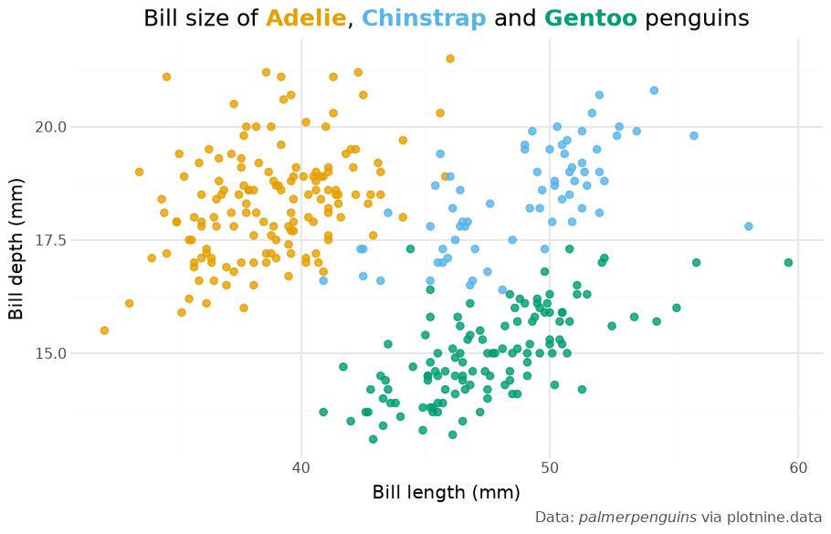

# ggtext

**Rich text for matplotlib and plotnine.** You can use Markdown, HTML, and inline CSS anywhere text appears in a plot: titles, subtitles, captions, axis titles, tick labels, facet strips, legends, and labels placed in the data.

This is a Python take on the R package [ggtext](https://wilkelab.org/ggtext/) by Claus Wilke. It is built for the Python/SciPy community. The core works with plain matplotlib, and plotnine support is an optional extra on top.



Parsing (markdown, HTML, inline CSS) is done by [ggIR](https://github.com/snake-case-ggtext/ggIR); ggtext measures and draws the result.

## Is ggtext-style text possible in plotnine? Yes.

[plotnine issue #612](https://github.com/has2k1/plotnine/issues/612) asked for ggtext-style rich text. The answer was that matplotlib's graphics stack made it "nearly impossible". The problem is that a matplotlib `Text` artist draws a string in a single style. Earlier workarounds stitch several `Text` objects together inside offset boxes. plotnine's layout engine can't see those boxes, and they can't be rotated.

ggtext takes a different route. Its `RichText` **is** a matplotlib `Text`. It overrides only the two methods everything else relies on: `_get_layout()` (measuring) and `draw()`. Because of that:

- plotnine's layout engine, legends, `constrained`/`tight` layout, and `bbox_inches="tight"` all reserve the right amount of space automatically.
- Rich text can be rotated to **any** angle, boxes included.
- A plain string in a `RichText` lands on exactly the same pixels as a plain `Text`. The test suite checks this across rotations, alignments, and line spacings on matplotlib 3.10 and 3.11.

plotnine styles all of its text with `text.set(**element.properties)`. ggtext registers a `richtext` property on matplotlib `Text`, so `element_markdown()` works for **every** text themeable without patching plotnine. [docs/design.md](docs/design.md) has the full story.

## Install

ggtext isn't on PyPI yet: its parser, [ggIR](https://github.com/snake-case-ggtext/ggIR), has to be published there first (see the [roadmap](docs/roadmap.md)). Install it from GitHub; this also installs ggIR:

```bash
pip install "ggtext[plotnine] @ git+https://github.com/snake-case-ggtext/ggtext_ShanEllis"   # with plotnine
pip install "ggtext @ git+https://github.com/snake-case-ggtext/ggtext_ShanEllis"             # matplotlib only
```

ggtext supports Python ≥ 3.10, matplotlib ≥ 3.10, and plotnine 0.15. To work on ggtext itself, see [Contributing](#contributing).

> **Version note:** matplotlib 3.11 requires Python ≥ 3.11. On Python 3.10, pip installs matplotlib 3.10, and ggtext supports both. The test suite runs on Python 3.10 + matplotlib 3.10 and on Python 3.11 + matplotlib 3.11.

## plotnine in 30 seconds

Swap `element_text()` for `element_markdown()`, then write Markdown or HTML in your labels:

```python
from plotnine import (
    ggplot,
    aes,
    geom_point,
    labs,
    theme,
    theme_minimal,
    scale_color_manual,
)
from plotnine.data import penguins
from ggtext import element_markdown

colors = {"Adelie": "#E69F00", "Chinstrap": "#56B4E9", "Gentoo": "#009E73"}

(
    ggplot(penguins.dropna(), aes("bill_length_mm", "bill_depth_mm", color="species"))
    + geom_point()
    + scale_color_manual(values=colors)
    + labs(
        title="Bill size of <span style='color:#E69F00'>**Adelie**</span>, "
        "<span style='color:#56B4E9'>**Chinstrap**</span> and "
        "<span style='color:#009E73'>**Gentoo**</span> penguins",
        caption="Data: *palmerpenguins*",
    )
    + theme_minimal()
    + theme(
        plot_title=element_markdown(size=14),
        plot_caption=element_markdown(),
        legend_position="none",
    )
)
```

### Long subtitles that wrap

`element_textbox_simple()` word-wraps text to the width of the panels, so a subtitle can be a real sentence or two. Here the colored words in the title also replace the legend:

```python
from plotnine import (
    aes,
    geom_line,
    ggplot,
    labs,
    scale_color_manual,
    scale_x_datetime,
    theme,
    theme_minimal,
)
from plotnine.data import economics_long
from ggtext import element_markdown, element_textbox_simple

BLUE, ORANGE = "#0072B2", "#D55E00"
df = economics_long[economics_long["variable"].isin(["psavert", "uempmed"])]

(
    ggplot(df, aes("date", "value", color="variable"))
    + geom_line(size=0.8)
    + scale_color_manual(values={"psavert": BLUE, "uempmed": ORANGE})
    + scale_x_datetime(date_labels="%Y")
    + labs(
        title=f"<span style='color:{BLUE}'>**Personal savings rate**</span> and "
        f"<span style='color:{ORANGE}'>**unemployment duration**</span>, 1967–2015",
        subtitle="This subtitle is drawn with **element_textbox_simple()**: it is "
        "word-wrapped to the width of the panel area, so you can write a real "
        "sentence or two about what the reader should notice. Styles such as "
        "*italics*, <span style='color:#0072B2'>**colored bold text**</span> and "
        "units like m<sup>2</sup> survive the line breaks.",
        x="",
        y="",
        caption="Source: *economics_long* (US FRED data) bundled with plotnine",
    )
    + theme_minimal()
    + theme(
        figure_size=(8, 5),
        legend_position="none",
        plot_title=element_markdown(size=14, ha="left"),
        plot_subtitle=element_textbox_simple(
            size=10,
            color="#333333",
            fill="#F2F2F2",
            padding=(6, 8),
            r=4,
            margin={"t": 4, "b": 10},
        ),
        plot_caption=element_markdown(size=8, color="#666666"),
    )
)
```


This is [`examples/03_titles_and_subtitles.py`](examples/03_titles_and_subtitles.py). For labels inside the panels, see the `geom_richtext()` and `geom_textbox()` geoms in the [plotnine guide](docs/plotnine.md#geoms).

## matplotlib in 30 seconds

```python
import matplotlib.pyplot as plt
import ggtext

fig, ax = plt.subplots(layout="constrained")
ax.plot([0, 1, 2], [0, 1, 4])
ggtext.set_title(ax, "<span style='color:#0072B2'>**Growth**</span> is *quadratic*")
ggtext.set_xlabel(ax, "time, *t* (s)")
ggtext.set_ylabel(ax, "area (m<sup>2</sup>)")
ggtext.textbox(
    ax, 0.6, 3, "A **word-wrapped** box, like ggtext's *geom_textbox*.", width="1.5in"
)

# Or turn any existing Text into rich text:
ggtext.richify(ax.title)
ax.text(1, 1, "**works** with ax.text too", richtext=True)
```


## What you can write

| Markdown | HTML | CSS (inside `style='...'`) |
|---|---|---|
| `**bold**`, `*italic*`, `***both***` | `<b>`, `<i>`, `<u>`, `<s>`, `<sup>`, `<sub>`, `<br>` | `color`, `font-size`, `font-family` |
| `~~strike~~`, `` `code` `` | `<span>`, `<font>`, `<code>`, `<mark>`, `<small>`, `<big>` | `font-weight`, `font-style`, `font-variant` |
| `[link](url)`, `` | ``, `<a href=>`, `<p>` | `background-color`, `text-decoration`, `vertical-align` |

You can also write `$...$` for matplotlib mathtext. `snake_case_names` stay literal. See the [syntax reference](docs/syntax.md) and the [cheatsheet image](docs/images/syntax_cheatsheet.png).

## What's in the package

`import ggtext` gives you 23 public names (`ggtext.__all__`). The five plotnine helpers import plotnine only when you first use one, so ggtext works without plotnine installed.

**plotnine** (also in `ggtext.plotnine`)

| Name | What it is |
|---|---|
| `element_markdown` | theme element: rich text for any text slot in `theme()` |
| `element_textbox` | theme element: word-wrapped rich text in a box |
| `element_textbox_simple` | `element_textbox` with full-width defaults, for long subtitles and captions |
| `geom_richtext` | rich text labels in the data, optionally boxed, at any angle |
| `geom_textbox` | word-wrapped rich text boxes in the data |

**matplotlib** (also in `ggtext.mpl`)

| Name | What it is |
|---|---|
| `text`, `textbox`, `annotate` | add rich text, a word-wrapped box, or an annotation with an arrow to an axes or figure |
| `set_title`, `set_suptitle`, `set_xlabel`, `set_ylabel` | rich versions of matplotlib's setters |
| `richify` | turn existing text objects (`ax.title`, legend text, ...) into rich text |
| `rich_ticklabels` | make an axis's tick labels rich, including ticks matplotlib creates later |

**Core objects and utilities**

| Name | What it is |
|---|---|
| `RichText` | the `matplotlib.text.Text` subclass that draws rich text |
| `RichTextSpec` | the rich text options: wrapping width, box fill and outline, padding, margins, alignment, ... |
| `make_rich`, `make_plain`, `is_rich` | convert a `Text` object to rich text and back, or check which it is |
| `parse` | turn a string into styled tokens (with ggIR); handy for debugging markup |
| `Style` | the style of one token (built on ggIR's `Style`) |
| `register_image` | make a numpy array or PIL image available to `` |
| `options` | package settings, e.g. `ggtext.options.allow_remote_images = False` |

Importing ggtext also adds a `richtext` property to matplotlib's `Text` (`ax.text(..., richtext=True)`, `text.set(richtext=...)`). That property is how the plotnine theme elements turn plotnine's own text into rich text; it adds to `Text` and changes nothing for plain text.

## Compared with R's ggtext

| Feature | Status |
|---|---|
| `element_markdown()`, `element_textbox()`, `element_textbox_simple()` | ✅ ported |
| `geom_richtext()`, `geom_textbox()` | ✅ ported |
| Markdown, HTML, and CSS subset, `` | ✅ ported; images can also come from numpy arrays via `register_image()` |
| Rich axis **tick labels** | ✅ ported, at any angle |
| Rotation of text boxes | ✨ improved: any angle (ggtext: 0/90/180/270 only) |
| Underline, strikethrough, inline code, highlight, links in SVG/PDF | ✨ new |
| Mathtext (`$\alpha$`) inside rich text | ✨ new |
| Plain matplotlib support (no plotnine needed) | ✨ new |
| plotnine compositions (`p1 \| p2`): wrapped text sized to each plot's own panels | ✨ new |
| `\n` as a line break (Python convention; `newline="space"` for Markdown behavior) | ✨ Pythonic default |
| `minwidth` / `maxwidth` / `minheight` / `maxheight`, margins | ✅ ported |
| Geoms: rotation around the anchor, `hjust`/`vjust` incl. `"inward"`/`"outward"`, mappable outline and text colors | ✅ ported |
| `align_widths` / `align_heights` | ⏳ not yet ([roadmap](docs/roadmap.md)) |

## Differences from ggtext

ggtext follows Python, matplotlib, and plotnine conventions where they differ from R/ggplot2. ggplot2 spellings are accepted as aliases so ported code keeps working.

| ggtext (R) | ggtext (Python) | Note |
|---|---|---|
| `plot.title`, `label.colour`, `box.size`, ... | `plot_title`, `label_color`, `box_size`, ... | dots become underscores; `colour` spellings are accepted |
| `hjust`, `vjust` | `ha`, `va` (aliases `hjust`, `vjust`) | names, numbers in [0, 1], or `"inward"`/`"outward"` |
| `angle` | `rotation` in theme elements; `angle` in geoms | as in plotnine |
| `lineheight` | `linespacing` (alias `lineheight`) | |
| `face = "bold"` | `weight="bold"`, `style="italic"` | `face` is accepted |
| `size = 3.88` (mm) in geoms | `size=11` (points) | plotnine's `geom_text` convention |
| `label.size`, `box.size` (mm) | `label_size`, `box_size` (points) | multiply R values by 72.27 / 25.4 ≈ 2.85 |
| `unit(2, "inch")`, `unit(1, "npc")` | `"2in"`, `1.0` | strings with units, or fractions of the panel |
| `padding`, `margin`, `r` as `grid::unit()` | numbers in points | `padding=(2, 4)` means (vertical, horizontal) |
| `width` includes `box.margin` | `width` is the box; margins are added outside | |
| `fill = NA`, `label.colour = NA` | `fill=None`, `label_color="none"` or `label_size=0` | `None` (the default) inherits the text color |
| a single newline is a space | `\n` is a line break | `newline="space"` gives R's behavior; `<br>` works in both |
| `` without size: natural pixel size | as tall as the font | set `width`/`height` for other sizes |
| text boxes rotate only 0/90/180/270 | any angle | `orientation=` names still work |
| unsupported tags are errors | a warning, and the text is still drawn | |
| — | `$...$` mathtext, underline, strikethrough, `<mark>`, inline code, links | additions |
| `align_widths`, `align_heights`, `rotate_margins` | not yet | see the [roadmap](docs/roadmap.md) |

## Documentation

- [Getting started](docs/getting-started.md)
- [Syntax reference](docs/syntax.md): everything you can write inside a label
- [plotnine guide](docs/plotnine.md): elements, geoms, and translating from R
- [matplotlib guide](docs/matplotlib.md): `RichText` and helper functions
- [Gallery](docs/gallery.md): every example image, with code
- [How it works / plotnine #612](docs/design.md)
- [Comparison with ggtext, flexitext, highlight_text](docs/comparison.md)
- [Roadmap and known limitations](docs/roadmap.md)
- A runnable notebook tour: [`examples/ggtext_tour.ipynb`](examples/ggtext_tour.ipynb)

## Testing

The suite has 1,060 tests in 13 files and covers 95% of the code. It runs on Python 3.10 + matplotlib 3.10 and Python 3.11 + matplotlib 3.11, both with plotnine 0.15.9. On Linux with matplotlib 3.11 everything runs except one test for the other matplotlib version's internal format (1,059 pass, 1 skipped). Elsewhere the 16 image comparisons are also skipped (see below). A full run takes 20–30 seconds.

```bash
make test                             # whole suite in random order, with coverage (uses uv)
```

Or with pip:

```bash
pip install -e ".[test,notebook]"     # the notebook extra runs examples/ggtext_tour.ipynb
pytest                                # everything
pytest -m image                       # only the image-comparison tests
pytest -m "not image and not notebook and not examples"   # the fast core
pytest --update-baselines -m image    # rewrite the image baselines after an intended change
pytest --doctest-modules src/ggtext   # examples in the docstrings
```

With the dev tools installed (`uv sync`), tests run in a random order (pytest-randomly) to catch tests that depend on each other. To reproduce a failure, rerun with the seed printed at the top: `pytest -p randomly --randomly-seed=<seed>`.

| File | Tests | What it checks |
|---|---|---|
| `tests/test_artist.py` | 670 | The core `RichText` artist |
| `tests/test_plotnine.py` | 100 | The plotnine integration |
| `tests/test_parse.py` | 60 | Markdown, HTML and math parsing, through `ggtext.parse()` |
| `tests/test_spec.py` | 46 | Rich-text options, validation, unit conversion |
| `tests/test_ir_adapter.py` | 42 | ggIR parsing gives the same tokens as ggtext's original parser |
| `tests/test_style.py` | 41 | Lengths, colors and CSS properties |
| `tests/test_layout.py` | 29 | The layout algorithm, isolated from matplotlib |
| `tests/test_mpl_api.py` | 28 | Plain-matplotlib helpers and image loading |
| `tests/test_geom_richtext_images.py` | 20 | `geom_richtext` against ggtext's image tests, plus justification |
| `tests/test_examples.py` | 12 | Every gallery example runs and writes its images |
| `tests/test_theme_images.py` | 6 | Theme text (titles, axes, strips, legends, tags) against baselines |
| `tests/test_geom_textbox_images.py` | 5 | `geom_textbox` against ggtext's image tests |
| `tests/test_notebook.py` | 1 | The tour notebook runs from top to bottom |

**The core artist (`test_artist.py`)**
- About 600 of the tests check placement: a plain string drawn as rich text must land on exactly the same pixels as a normal matplotlib `Text`, across every rotation, alignment and rotation-mode combination. This is why plotnine's layout can treat rich text like ordinary text, and it is what would catch a matplotlib update breaking the internals ggtext relies on.
- Size behaviour: bold text is wider, a big span makes the line taller, padding and margins grow the box, and fixed, maximum, minimum and fractional widths and heights come out the right size.
- Pixel checks: the figure is rendered and inspected for the right colors, fills, highlights, underlines, transparency and inline images.
- Every output format: PNG, PDF, SVG, PS and EPS; the SVG check confirms links are written out.
- Converting existing text in place and back, saving and reloading figures (pickling), matplotlib's constrained and tight layouts, the two-pass layout, and the font-metric caches (keyed on the actual font file, so a font change can't reuse stale measurements).

**The plotnine integration (`test_plotnine.py`)**
- Every text slot works with `element_markdown`: title, subtitle, caption, tag, both axis titles, legend title and labels, facet strips, and tick labels on each axis. Slots you didn't style stay plain.
- Theme combinations: complete themes such as `theme_bw`, `theme(text=...)`, overriding with `element_text`, and `element_blank`.
- Layout: tall titles get room, a wrapped subtitle spans exactly the panel width without overlapping anything, rotated tick labels and boxed axis titles fit, and in side-by-side plots (`p1 | p2`) each subtitle wraps to its own plot's panels.
- The geoms: boxes, mapped fills and outline colors, text color, justification (numbers and `"inward"`/`"outward"`), rotation around the anchor, margins, min/max sizes, `orientation`, `format_string`, and missing labels.
- The ggplot2 spellings (`colour`, `hjust`, `box.colour`, ...), saving to PNG, PDF and SVG, and one full example that must render with no warnings.

**Image comparisons (`test_geom_richtext_images.py`, `test_geom_textbox_images.py`, `test_theme_images.py`)**
- **Geoms (10 comparisons):** ported from [plotnine-ggtext](https://github.com/snake-case-ggtext/plotnine-ggtext), one test for each of ggtext's own `vdiffr` snapshot tests for the two geoms, with the same data and parameters, plus the roxygen examples. The R ggtext renderings of the same plots are in `tests/reference_r/` for side-by-side comparison; recreate them with `Rscript tests/reference_r/render.R`.
- **Theme text (6 comparisons):** the text around the panels, where plotnine's layout has to make room for rich text: a colored title with a wrapped, boxed `element_textbox_simple` subtitle and a caption; a boxed title and a tag; rich axis titles, a wrapping rotated textbox y title and rotated rich tick labels; top and right facet strips; a legend with rich labels and a multi-line title; and a colorbar title in a bottom legend.
- Each plot is saved at 640 × 480 pixels with DejaVu fonts and compared with a baseline in `tests/baseline_images/` (RMS tolerance 2, as in plotnine). Results and diffs go to `tests/result_images/`, which git ignores.
- Baselines depend on how text is rasterized, which differs between platforms and between the FreeType versions bundled with matplotlib 3.10 and 3.11. They are made in one reference environment, **Linux with matplotlib 3.11**. Anywhere else the plots are still drawn, so the code paths run, but the pixel comparison is skipped with the reason shown, and `--update-baselines` refuses to overwrite the baselines. Set `GGTEXT_IMAGE_TESTS=force` to compare or update anyway.
- The geom image files also hold 15 unit tests for justification (`resolve_just`, including `"inward"`/`"outward"`), nudging, unsupported tags and orientations.
- The image harness (`tests/image_compare.py`) is switched on only for tests marked `image`, so the rest of the suite is unaffected.

**Examples and notebook (`test_examples.py`, `test_notebook.py`)**
- Every `examples/NN_*.py` script runs with warnings treated as errors and must write non-empty images. The images go to a temporary folder (`GGTEXT_EXAMPLES_OUT`), so tests never touch `docs/images/`; `python examples/run_all.py` still regenerates the gallery.
- `examples/ggtext_tour.ipynb` is executed from top to bottom with nbclient and must finish with no errors and show its figures. It needs the `notebook` extra and is skipped without it.

**Parsing (`test_parse.py`, `test_ir_adapter.py`)**
- Parsing is done by [ggIR](https://github.com/snake-case-ggtext/ggIR); `test_parse.py` checks the result through `ggtext.parse()`: every supported Markdown and HTML feature, nesting, unclosed tags, unknown tags (which warn) and comments.
- Python-specific cases: `bill_length_mm` stays literal, the `__init__` gotcha (it renders as bold "init") and its fixes, `\n` behaviour, and math with escaped `\$`.
- `test_ir_adapter.py` is a golden test for the move to ggIR. It runs every string in the tests, examples and docs, plus edge cases, under all 16 option combinations, and checks that `ggtext.parse()` (now `ggir.parse` followed by `ggir.resolve`) gives exactly the tokens of ggtext's original parser, which is frozen in `tests/_legacy_parse.py`. The few malformed-HTML inputs where ggIR is deliberately more correct are listed in the test.

**Layout (`test_layout.py`)** uses a fake text-measuring stand-in with predictable sizes, so positions can be checked by hand: wrapping, alignment, line spacing for both matplotlib versions, superscripts, padding, margins, fixed heights with overflow, and non-breaking spaces.

**Not covered yet**
- **Plot compositions in images:** side-by-side plots (`p1 | p2`) are checked by geometry, not against a baseline image.
- **Remote images:** downloading images from URLs isn't tested, because it needs the network.

There is no CI: run the checks locally before pushing. `make test` runs the suite and `make lint` runs ruff and type checking ([pyrefly](https://pyrefly.org/), strict, with existing errors recorded in `pyrefly-baseline.json`); the pre-commit hooks run ruff and pyrefly on every commit. Run the suite on both version setups (Python 3.10 + matplotlib 3.10 and Python 3.11 + matplotlib 3.11; see [CONTRIBUTING.md](CONTRIBUTING.md)), and update image baselines only on Linux with matplotlib 3.11.

## Contributing

Contributions are welcome. With [uv](https://docs.astral.sh/uv/):

```bash
make install             # uv sync (the package plus pytest, ruff, pyrefly, prek, ...) and the git hooks
make test                # tests in random order, with coverage
make lint                # ruff check, ruff format --check, pyrefly
make pre-commit          # run the git hooks (ruff, pyrefly, file checks) on every file
```

[CONTRIBUTING.md](CONTRIBUTING.md) covers the setup for both version matrices (including plain `pip`), the tests and image baselines, and how to regenerate the gallery.

## Credits

The design follows [ggtext](https://wilkelab.org/ggtext/) and [gridtext](https://wilkelab.org/gridtext/) by Claus O. Wilke. The two earlier Python attempts, [flexitext](https://github.com/tomicapretto/flexitext) by Tomás Capretto and [highlight_text](https://github.com/znstrider/highlight_text) by Danny Phan, showed what Python users want from this. No code was copied from these projects.

Parsing is done by [ggIR](https://github.com/snake-case-ggtext/ggIR). The image-comparison tests for the geoms, with their R reference renders, were ported from [plotnine-ggtext](https://github.com/snake-case-ggtext/plotnine-ggtext) by Tyler Riccio, who also contributed the ggIR integration and the development tooling.

MIT licensed.
