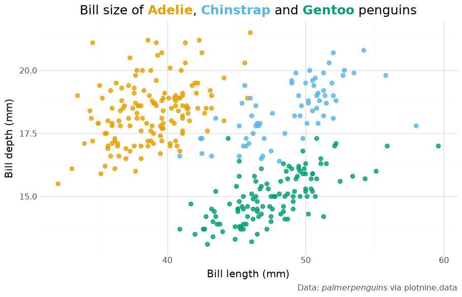
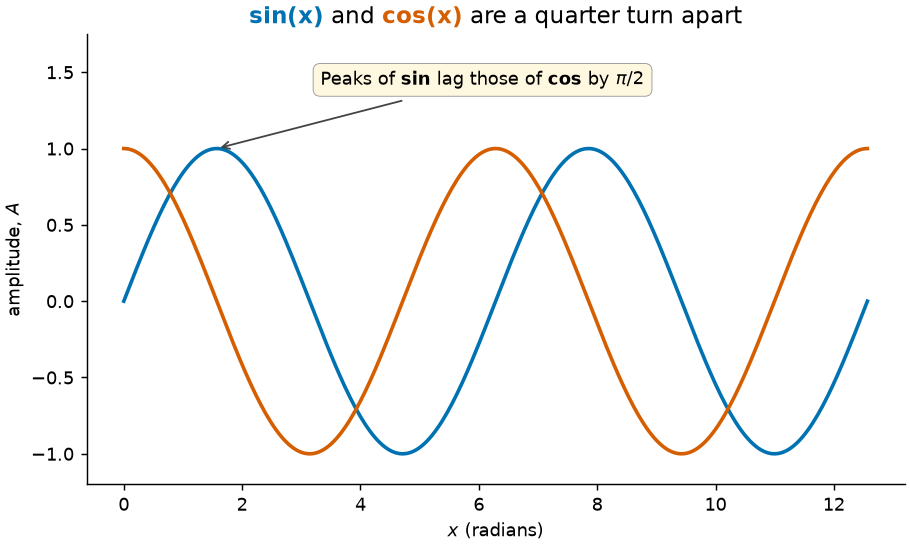
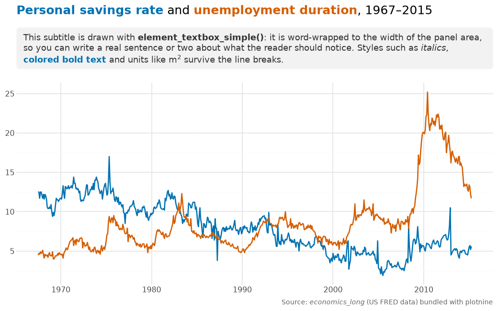
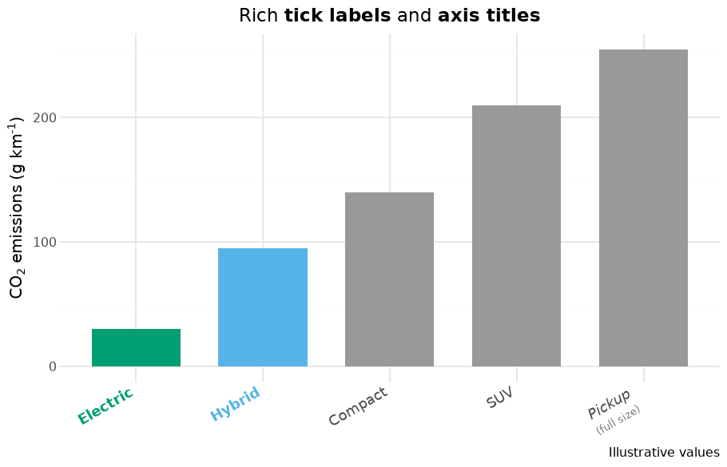
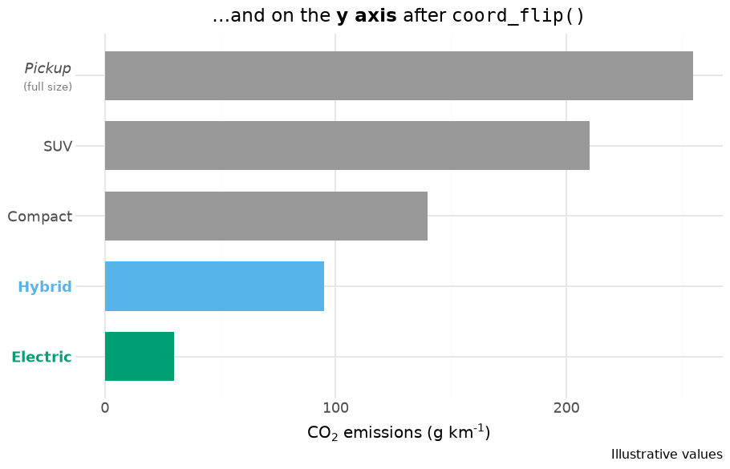
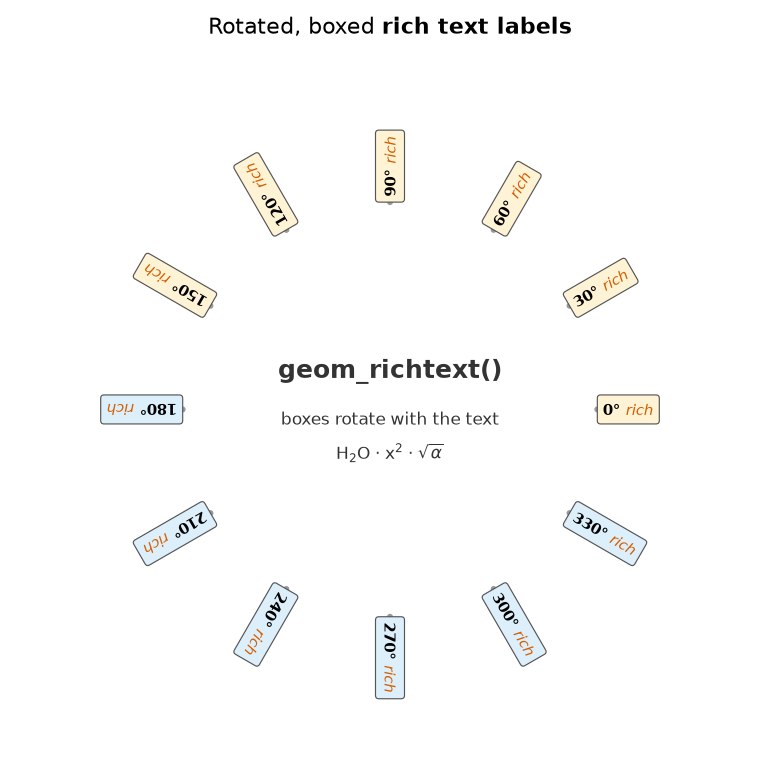
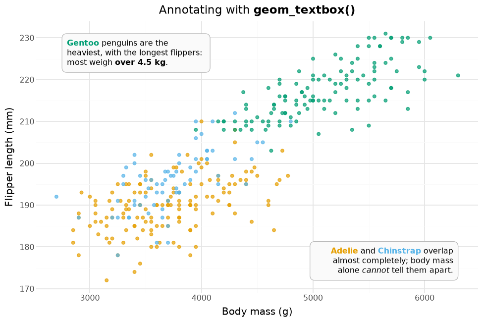
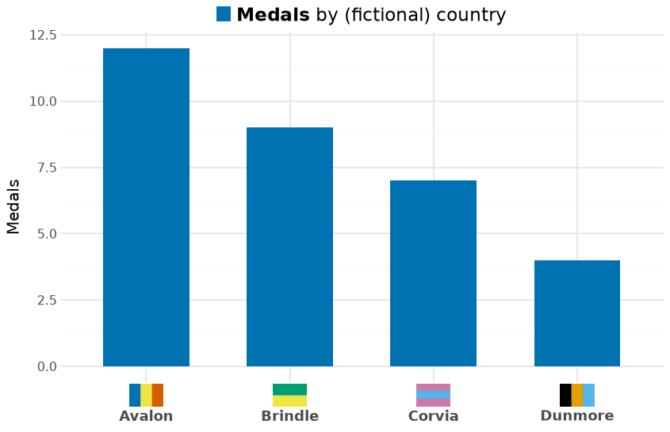
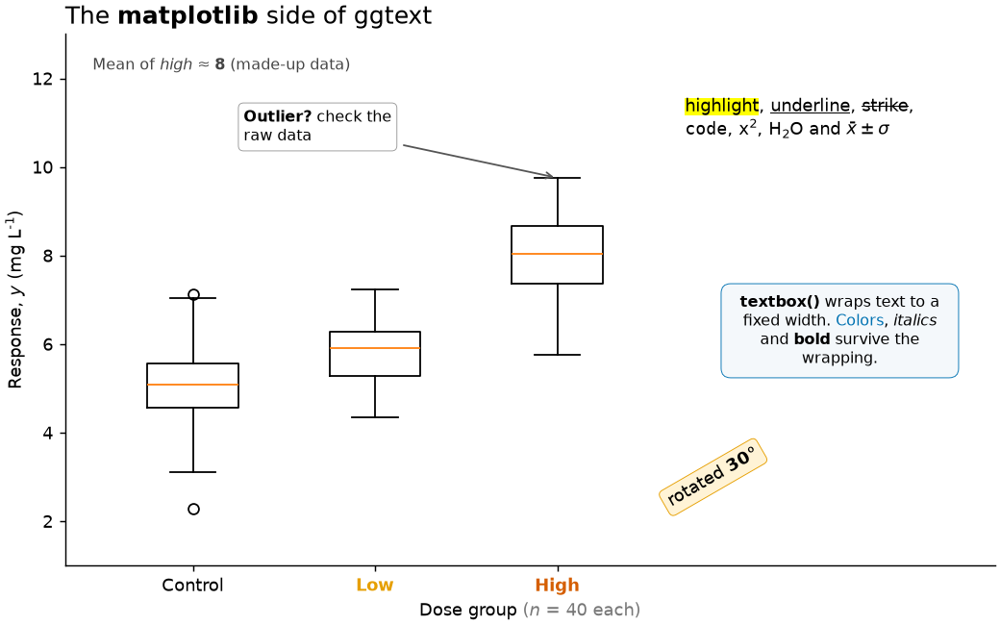
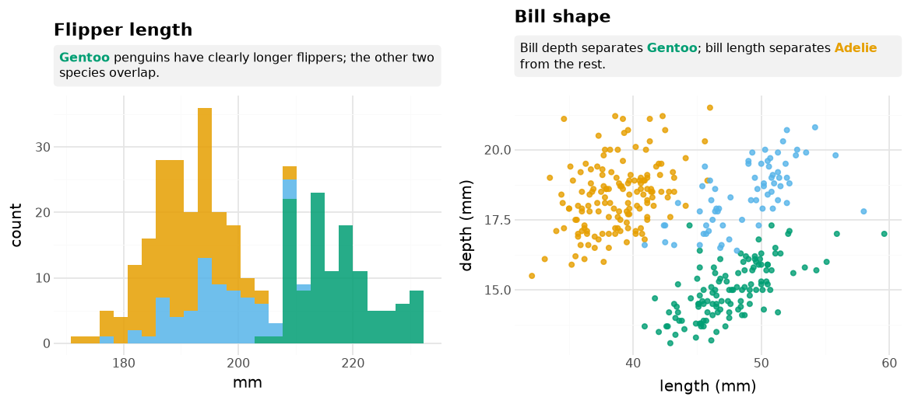

# Gallery

Every image in the documentation, with the code that made it. The scripts live in `examples/`; run `python examples/run_all.py` to regenerate the images and `python examples/make_gallery.py` to rebuild this page.

| Example | Script |
|---|---|
| [Quickstart: rich text in a plotnine plot](#quickstart-plotnine) | `examples/01_quickstart_plotnine.py` |
| [Quickstart: rich text with plain matplotlib (no plotnine needed)](#quickstart-matplotlib) | `examples/02_quickstart_matplotlib.py` |
| [Titles, subtitles and captions](#titles-and-subtitles) | `examples/03_titles_and_subtitles.py` |
| [Axis titles and tick labels](#axis-and-tick-labels) | `examples/04_axis_and_tick_labels.py` |
| [Facet strips and legends](#facet-strips-and-legends) | `examples/05_facet_strips_and_legends.py` |
| [geom_richtext: rich text labels, with or without a box, at any angle](#geom-richtext) | `examples/06_geom_richtext.py` |
| [geom_textbox: word-wrapped rich text in boxes of a fixed width](#geom-textbox) | `examples/07_geom_textbox.py` |
| [Images inside text: &lt;img&gt; tags in tick labels and titles](#images-in-labels) | `examples/08_images_in_labels.py` |
| [A tour of the matplotlib helpers](#matplotlib-features) | `examples/09_matplotlib_features.py` |
| [A visual cheatsheet: every supported syntax element next to its source](#syntax-cheatsheet) | `examples/10_syntax_cheatsheet.py` |
| [Plot compositions: rich text in p1 \| p2](#plot-composition) | `examples/11_plot_composition.py` |

<a id="quickstart-plotnine"></a>

## Quickstart: rich text in a plotnine plot

The colored words in the title double as the legend, so the legend
itself can be dropped. This is the classic ggtext use case.



<details><summary>Code: <code>examples/01_quickstart_plotnine.py</code></summary>

```python
"""
Quickstart: rich text in a plotnine plot.

The colored words in the title double as the legend, so the legend
itself can be dropped. This is the classic ggtext use case.

Run:  python examples/01_quickstart_plotnine.py
"""

from pathlib import Path

import matplotlib

matplotlib.use("Agg")

from plotnine import (  # noqa: E402
    aes,
    geom_point,
    ggplot,
    labs,
    scale_color_manual,
    theme,
    theme_minimal,
)
from plotnine.data import penguins  # noqa: E402

from ggtext import element_markdown  # noqa: E402

OUT = Path(__file__).resolve().parent.parent / "docs" / "images"
OUT.mkdir(parents=True, exist_ok=True)

# Okabe-Ito colors, an accessible palette
COLORS = {"Adelie": "#E69F00", "Chinstrap": "#56B4E9", "Gentoo": "#009E73"}

title = (
    "Bill size of "
    f"<span style='color:{COLORS['Adelie']}'>**Adelie**</span>, "
    f"<span style='color:{COLORS['Chinstrap']}'>**Chinstrap**</span> and "
    f"<span style='color:{COLORS['Gentoo']}'>**Gentoo**</span> penguins"
)

p = (
    ggplot(penguins.dropna(), aes("bill_length_mm", "bill_depth_mm", color="species"))
    + geom_point(size=2, alpha=0.8)
    + scale_color_manual(values=COLORS)
    + labs(
        title=title,
        x="Bill length (mm)",
        y="Bill depth (mm)",
        caption="Data: *palmerpenguins* via plotnine.data",
    )
    + theme_minimal()
    + theme(
        plot_title=element_markdown(size=14),
        plot_caption=element_markdown(color="#555555"),
        legend_position="none",
        figure_size=(7, 4.5),
    )
)

if __name__ == "__main__":
    p.save(OUT / "quickstart_plotnine.png", dpi=130, verbose=False)
    print("wrote", OUT / "quickstart_plotnine.png")
```

</details>

<a id="quickstart-matplotlib"></a>

## Quickstart: rich text with plain matplotlib (no plotnine needed)



<details><summary>Code: <code>examples/02_quickstart_matplotlib.py</code></summary>

```python
"""
Quickstart: rich text with plain matplotlib (no plotnine needed).

Run:  python examples/02_quickstart_matplotlib.py
"""

from pathlib import Path

import matplotlib

matplotlib.use("Agg")

import matplotlib.pyplot as plt  # noqa: E402
import numpy as np  # noqa: E402

import ggtext  # noqa: E402

OUT = Path(__file__).resolve().parent.parent / "docs" / "images"
OUT.mkdir(parents=True, exist_ok=True)

BLUE, ORANGE = "#0072B2", "#D55E00"

x = np.linspace(0, 4 * np.pi, 300)
fig, ax = plt.subplots(figsize=(7, 4.2), dpi=130, layout="constrained")
ax.plot(x, np.sin(x), color=BLUE, lw=2)
ax.plot(x, np.cos(x), color=ORANGE, lw=2)

ggtext.set_title(
    ax,
    f"<span style='color:{BLUE}'>**sin(x)**</span> and "
    f"<span style='color:{ORANGE}'>**cos(x)**</span> are a quarter turn apart",
    fontsize=13,
)
ggtext.set_xlabel(ax, "*x* (radians)")
ggtext.set_ylabel(ax, "amplitude, $A$")

ggtext.annotate(
    ax,
    "Peaks of **sin** lag those of **cos** by $\\pi/2$",
    xy=(np.pi / 2, 1),
    xytext=(3.2, 1.45),
    va="center",
    arrowprops=dict(arrowstyle="->", color="#444444"),
    fill="#FFF8E1",
    box_color="#999999",
    padding=4,
    r=4,
    fontsize=10,
)
ax.set_ylim(-1.2, 1.75)
ax.spines[["top", "right"]].set_visible(False)

if __name__ == "__main__":
    fig.savefig(OUT / "quickstart_matplotlib.png")
    print("wrote", OUT / "quickstart_matplotlib.png")
```

</details>

<a id="titles-and-subtitles"></a>

## Titles, subtitles and captions

- The title uses colored words as an inline legend (element_markdown).
- The long subtitle is word-wrapped to the width of the panel area
  (element_textbox_simple), with a light background box.
- The caption mixes italics and a link-style source note.



<details><summary>Code: <code>examples/03_titles_and_subtitles.py</code></summary>

```python
"""
Titles, subtitles and captions.

- The title uses colored words as an inline legend (element_markdown).
- The long subtitle is word-wrapped to the width of the panel area
  (element_textbox_simple), with a light background box.
- The caption mixes italics and a link-style source note.

Run:  python examples/03_titles_and_subtitles.py
"""

from pathlib import Path

import matplotlib

matplotlib.use("Agg")

from plotnine import (  # noqa: E402
    aes,
    geom_line,
    ggplot,
    labs,
    scale_color_manual,
    scale_x_datetime,
    theme,
    theme_minimal,
)
from plotnine.data import economics_long  # noqa: E402

from ggtext import element_markdown, element_textbox_simple  # noqa: E402

OUT = Path(__file__).resolve().parent.parent / "docs" / "images"
OUT.mkdir(parents=True, exist_ok=True)

BLUE, ORANGE = "#0072B2", "#D55E00"

df = economics_long[economics_long["variable"].isin(["psavert", "uempmed"])]

title = (
    f"<span style='color:{BLUE}'>**Personal savings rate**</span> and "
    f"<span style='color:{ORANGE}'>**unemployment duration**</span>, 1967–2015"
)
subtitle = (
    "This subtitle is drawn with **element_textbox_simple()**: it is "
    "word-wrapped to the width of the panel area, so you can write a real "
    "sentence or two about what the reader should notice. Styles such as "
    "*italics*, <span style='color:#0072B2'>**colored bold text**</span> and "
    "units like m<sup>2</sup> survive the line breaks."
)

p = (
    ggplot(df, aes("date", "value", color="variable"))
    + geom_line(size=0.8)
    + scale_color_manual(values={"psavert": BLUE, "uempmed": ORANGE})
    + scale_x_datetime(date_labels="%Y")
    + labs(
        title=title,
        subtitle=subtitle,
        x="",
        y="",
        caption="Source: *economics_long* (US FRED data) bundled with plotnine",
    )
    + theme_minimal()
    + theme(
        figure_size=(8, 5),
        legend_position="none",
        plot_title=element_markdown(size=14, ha="left"),
        plot_subtitle=element_textbox_simple(
            size=10,
            color="#333333",
            fill="#F2F2F2",
            padding=(6, 8),
            r=4,
            margin={"t": 4, "b": 10},
        ),
        plot_caption=element_markdown(size=8, color="#666666"),
    )
)

if __name__ == "__main__":
    p.save(OUT / "titles_and_subtitles.png", dpi=130, verbose=False)
    print("wrote", OUT / "titles_and_subtitles.png")
```

</details>

<a id="axis-and-tick-labels"></a>

## Axis titles and tick labels

- Axis titles with units written with <sub>/<sup>.
- Rich tick labels: each category label has its own style, and the
  labels are rotated (any angle works).





<details><summary>Code: <code>examples/04_axis_and_tick_labels.py</code></summary>

```python
"""
Axis titles and tick labels.

- Axis titles with units written with <sub>/<sup>.
- Rich tick labels: each category label has its own style, and the
  labels are rotated (any angle works).

Run:  python examples/04_axis_and_tick_labels.py
"""

from pathlib import Path

import matplotlib

matplotlib.use("Agg")

import pandas as pd  # noqa: E402
from plotnine import (  # noqa: E402
    aes,
    coord_flip,
    geom_col,
    ggplot,
    labs,
    scale_fill_manual,
    scale_x_discrete,
    theme,
    theme_minimal,
)

from ggtext import element_markdown  # noqa: E402

OUT = Path(__file__).resolve().parent.parent / "docs" / "images"
OUT.mkdir(parents=True, exist_ok=True)

# Illustrative (made-up) emissions of some car classes
df = pd.DataFrame(
    {
        "vehicle": ["ev", "hybrid", "compact", "suv", "pickup"],
        "co2": [30, 95, 140, 210, 255],
        "kind": ["electric", "hybrid", "gas", "gas", "gas"],
    }
)
labels = {
    "ev": "<span style='color:#009E73'>**Electric**</span>",
    "hybrid": "<span style='color:#56B4E9'>**Hybrid**</span>",
    "compact": "Compact",
    "suv": "SUV",
    "pickup": "*Pickup*<br><span style='font-size:7pt;color:#777'>(full size)</span>",
}

p = (
    ggplot(df, aes("vehicle", "co2", fill="kind"))
    + geom_col(width=0.7)
    + scale_x_discrete(limits=list(labels), labels=list(labels.values()))
    + scale_fill_manual(
        values={"electric": "#009E73", "hybrid": "#56B4E9", "gas": "#999999"}
    )
    + labs(
        x="",
        y="CO<sub>2</sub> emissions (g km<sup>-1</sup>)",
        title="Rich **tick labels** and **axis titles**",
        caption="Illustrative values",
    )
    + theme_minimal()
    + theme(
        figure_size=(7, 4.5),
        legend_position="none",
        plot_title=element_markdown(size=13),
        axis_title_y=element_markdown(size=11),
        axis_text_x=element_markdown(size=10, rotation=30, ha="right"),
    )
)

# The same labels on a horizontal bar chart: tick labels on the y axis
p2 = (
    p
    + coord_flip()
    + labs(title="…and on the **y axis** after `coord_flip()`")
    + theme(
        axis_text_x=element_markdown(rotation=0, ha="center"),
        axis_text_y=element_markdown(size=10, ha="right"),
        axis_title_x=element_markdown(size=11),
    )
)

if __name__ == "__main__":
    p.save(OUT / "axis_and_tick_labels.png", dpi=130, verbose=False)
    p2.save(OUT / "axis_and_tick_labels_flipped.png", dpi=130, verbose=False)
    print("wrote", OUT / "axis_and_tick_labels.png")
    print("wrote", OUT / "axis_and_tick_labels_flipped.png")
```

</details>

<a id="facet-strips-and-legends"></a>

## Facet strips and legends

- Facet labels built with a labeller function that returns markup.
- Legend title on two lines, with a smaller grey second line.
- Legend labels with mixed styles.


<details><summary>Code: <code>examples/05_facet_strips_and_legends.py</code></summary>

```python
"""
Facet strips and legends.

- Facet labels built with a labeller function that returns markup.
- Legend title on two lines, with a smaller grey second line.
- Legend labels with mixed styles.

Run:  python examples/05_facet_strips_and_legends.py
"""

from pathlib import Path

import matplotlib

matplotlib.use("Agg")

from plotnine import (  # noqa: E402
    aes,
    facet_wrap,
    geom_point,
    ggplot,
    labs,
    scale_color_manual,
    theme,
    theme_bw,
)
from plotnine.data import penguins  # noqa: E402

from ggtext import element_markdown  # noqa: E402

OUT = Path(__file__).resolve().parent.parent / "docs" / "images"
OUT.mkdir(parents=True, exist_ok=True)

ISLAND_N = penguins.dropna().groupby("island", observed=True).size().to_dict()


def island_label(island: str) -> str:
    """Facet label: bold island name and a grey sample size."""
    return f"**{island}** <span style='color:#666666'>(*n* = {ISLAND_N[island]})</span>"


p = (
    ggplot(penguins.dropna(), aes("flipper_length_mm", "body_mass_g", color="sex"))
    + geom_point(alpha=0.7)
    + facet_wrap("island", labeller=island_label)
    + scale_color_manual(
        values={"female": "#CC79A7", "male": "#0072B2"},
        labels=[
            "<span style='color:#CC79A7'>**female**</span>",
            "<span style='color:#0072B2'>**male**</span>",
        ],
    )
    + labs(
        x="Flipper length (mm)",
        y="Body mass (g)",
        color="**Sex**<br><span style='font-size:8pt;color:#777777'>as recorded</span>",
        title="Rich **facet strips** and **legends**",
    )
    + theme_bw()
    + theme(
        figure_size=(8, 3.8),
        plot_title=element_markdown(size=13),
        strip_text=element_markdown(size=10),
        legend_title=element_markdown(),
        legend_text=element_markdown(),
    )
)

if __name__ == "__main__":
    p.save(OUT / "facet_strips_and_legends.png", dpi=130, verbose=False)
    print("wrote", OUT / "facet_strips_and_legends.png")
```

</details>

<a id="geom-richtext"></a>

## geom_richtext: rich text labels, with or without a box, at any angle

Unlike plotnine's geom_label, boxed labels can be rotated.



<details><summary>Code: <code>examples/06_geom_richtext.py</code></summary>

```python
"""
geom_richtext: rich text labels, with or without a box, at any angle.

Unlike plotnine's geom_label, boxed labels can be rotated.

Run:  python examples/06_geom_richtext.py
"""

from pathlib import Path

import matplotlib

matplotlib.use("Agg")

import numpy as np  # noqa: E402
import pandas as pd  # noqa: E402
from plotnine import (  # noqa: E402
    aes,
    coord_fixed,
    geom_point,
    ggplot,
    labs,
    lims,
    scale_fill_manual,
    theme,
    theme_void,
)

from ggtext import element_markdown, geom_richtext  # noqa: E402

OUT = Path(__file__).resolve().parent.parent / "docs" / "images"
OUT.mkdir(parents=True, exist_ok=True)

# Labels arranged on a circle, each rotated to point outwards
angles = np.arange(0, 360, 30)
df = pd.DataFrame(
    {
        "x": 1.2 * np.cos(np.radians(angles)),
        "y": 1.2 * np.sin(np.radians(angles)),
        "angle": angles,
        "label": [
            f"**{a}°** <span style='color:#D55E00'>*rich*</span>" for a in angles
        ],
        "half": np.where(angles < 180, "top", "bottom"),
    }
)
center = pd.DataFrame(
    {
        "x": [0, 0, 0],
        "y": [0.22, -0.05, -0.25],
        "label": [
            "<span style='font-size:15pt'>**geom_richtext()**</span>",
            "boxes rotate with the text",
            "H<sub>2</sub>O · x<sup>2</sup> · $\\sqrt{\\alpha}$",
        ],
    }
)

p = (
    ggplot(df, aes("x", "y"))
    + geom_point(color="#999999", size=1)
    + geom_richtext(
        aes(label="label", angle="angle", fill="half"),
        ha="left",
        nudge_x=0,
        size=9,
        label_color="#555555",
    )
    + geom_richtext(
        aes(label="label"),
        data=center,
        fill=None,
        label_size=0,
        size=10,
        color="#333333",
    )
    + scale_fill_manual(values={"top": "#FFF3D6", "bottom": "#DCEFFA"}, guide=None)
    + lims(x=(-1.95, 1.95), y=(-1.95, 1.95))
    + coord_fixed()
    + labs(title="Rotated, boxed **rich text labels**")
    + theme_void()
    + theme(
        figure_size=(6.5, 6.5),
        plot_title=element_markdown(size=13, margin={"t": 10}),
    )
)

if __name__ == "__main__":
    p.save(OUT / "geom_richtext.png", dpi=120, verbose=False)
    print("wrote", OUT / "geom_richtext.png")
```

</details>

<a id="geom-textbox"></a>

## geom_textbox: word-wrapped rich text in boxes of a fixed width

Handy for annotating a plot with a few sentences.



<details><summary>Code: <code>examples/07_geom_textbox.py</code></summary>

```python
"""
geom_textbox: word-wrapped rich text in boxes of a fixed width.

Handy for annotating a plot with a few sentences.

Run:  python examples/07_geom_textbox.py
"""

from pathlib import Path

import matplotlib

matplotlib.use("Agg")

import pandas as pd  # noqa: E402
from plotnine import (  # noqa: E402
    aes,
    geom_point,
    ggplot,
    labs,
    scale_color_manual,
    theme,
    theme_minimal,
)
from plotnine.data import penguins  # noqa: E402

from ggtext import element_markdown, geom_textbox  # noqa: E402

OUT = Path(__file__).resolve().parent.parent / "docs" / "images"
OUT.mkdir(parents=True, exist_ok=True)

COLORS = {"Adelie": "#E69F00", "Chinstrap": "#56B4E9", "Gentoo": "#009E73"}
pg = penguins.dropna()

notes = pd.DataFrame(
    {
        "x": [2750, 6300],
        "y": [231, 172],
        "ha": ["left", "right"],
        "va": ["top", "bottom"],
        "label": [
            f"<span style='color:{COLORS['Gentoo']}'>**Gentoo**</span> penguins are the "
            "heaviest, with the longest flippers: most weigh **over 4.5 kg**.",
            f"<span style='color:{COLORS['Adelie']}'>**Adelie**</span> and "
            f"<span style='color:{COLORS['Chinstrap']}'>**Chinstrap**</span> overlap almost "
            "completely; body mass alone *cannot* tell them apart.",
        ],
        "halign": ["left", "right"],
    }
)

p = (
    ggplot(pg, aes("body_mass_g", "flipper_length_mm"))
    + geom_point(aes(color="species"), alpha=0.7)
    + geom_textbox(
        aes("x", "y", label="label", halign="halign", ha="ha", va="va"),
        data=notes,
        width="2.3in",
        size=9,
        fill="#FAFAFA",
        box_color="#BBBBBB",
    )
    + scale_color_manual(values=COLORS, guide=None)
    + labs(
        x="Body mass (g)",
        y="Flipper length (mm)",
        title="Annotating with **geom_textbox()**",
    )
    + theme_minimal()
    + theme(figure_size=(7.5, 5), plot_title=element_markdown(size=13))
)

if __name__ == "__main__":
    p.save(OUT / "geom_textbox.png", dpi=130, verbose=False)
    print("wrote", OUT / "geom_textbox.png")
```

</details>

<a id="images-in-labels"></a>

## Images inside text: &lt;img&gt; tags in tick labels and titles

To keep this example self-contained (no downloads, no files), the
"flags" are tiny numpy arrays registered with ggtext.register_image().
With real files you would write .



<details><summary>Code: <code>examples/08_images_in_labels.py</code></summary>

```python
"""
Images inside text:  tags in tick labels and titles.

To keep this example self-contained (no downloads, no files), the
"flags" are tiny numpy arrays registered with ggtext.register_image().
With real files you would write .

Run:  python examples/08_images_in_labels.py
"""

from pathlib import Path

import matplotlib

matplotlib.use("Agg")

import numpy as np  # noqa: E402
import pandas as pd  # noqa: E402
from plotnine import (  # noqa: E402
    aes,
    geom_col,
    ggplot,
    labs,
    scale_x_discrete,
    theme,
    theme_minimal,
)

import ggtext  # noqa: E402
from ggtext import element_markdown  # noqa: E402

OUT = Path(__file__).resolve().parent.parent / "docs" / "images"
OUT.mkdir(parents=True, exist_ok=True)


def stripes(colors, vertical=True, h=20, w=30):
    """A tiny striped 'flag' as an (h, w, 3) float array."""
    img = np.zeros((h, w, 3))
    n = len(colors)
    for i, c in enumerate(colors):
        rgb = np.array(matplotlib.colors.to_rgb(c))
        if vertical:
            img[:, i * w // n : (i + 1) * w // n] = rgb
        else:
            img[i * h // n : (i + 1) * h // n, :] = rgb
    return img


# Made-up flags for made-up countries
flags = {
    "Avalon": stripes(["#0072B2", "#F0E442", "#D55E00"]),
    "Brindle": stripes(["#009E73", "#F0E442"], vertical=False),
    "Corvia": stripes(["#CC79A7", "#56B4E9", "#CC79A7"], vertical=False),
    "Dunmore": stripes(["#000000", "#E69F00", "#56B4E9"]),
}
for name, img in flags.items():
    ggtext.register_image(f"flag_{name}", img)

# A color swatch for the title
ggtext.register_image("swatch", stripes(["#0072B2"], h=10, w=10))

df = pd.DataFrame({"country": list(flags), "medals": [12, 9, 7, 4]})
labels = [f"<br>**{c}**" for c in flags]

p = (
    ggplot(df, aes("country", "medals"))
    + geom_col(fill="#0072B2", width=0.6)
    + scale_x_discrete(limits=list(flags), labels=labels)
    + labs(
        x="",
        y="Medals",
        title=" **Medals** by (fictional) country",
    )
    + theme_minimal()
    + theme(
        figure_size=(6.5, 4.2),
        plot_title=element_markdown(size=13),
        axis_text_x=element_markdown(size=10, linespacing=1.4),
    )
)

if __name__ == "__main__":
    p.save(OUT / "images_in_labels.png", dpi=130, verbose=False)
    print("wrote", OUT / "images_in_labels.png")
```

</details>

<a id="matplotlib-features"></a>

## A tour of the matplotlib helpers

- ggtext.text / textbox / annotate / set_title / set_xlabel / set_ylabel
- rich tick labels with ggtext.rich_ticklabels
- turning an existing artist into rich text with ggtext.richify
- boxes, rotation, highlights, underline/strikethrough, mathtext



<details><summary>Code: <code>examples/09_matplotlib_features.py</code></summary>

```python
"""
A tour of the matplotlib helpers.

- ggtext.text / textbox / annotate / set_title / set_xlabel / set_ylabel
- rich tick labels with ggtext.rich_ticklabels
- turning an existing artist into rich text with ggtext.richify
- boxes, rotation, highlights, underline/strikethrough, mathtext

Run:  python examples/09_matplotlib_features.py
"""

from pathlib import Path

import matplotlib

matplotlib.use("Agg")

import matplotlib.pyplot as plt  # noqa: E402
import numpy as np  # noqa: E402

import ggtext  # noqa: E402

OUT = Path(__file__).resolve().parent.parent / "docs" / "images"
OUT.mkdir(parents=True, exist_ok=True)

rng = np.random.default_rng(1)
groups = ["control", "low", "high"]
values = [rng.normal(m, 1, 40) for m in (5, 6, 8)]

fig, ax = plt.subplots(figsize=(8, 5), dpi=130, layout="constrained")
ax.boxplot(values, widths=0.5)
ax.set_xlim(0.3, 5.4)
ax.set_ylim(1, 13)
ax.spines[["top", "right"]].set_visible(False)

# Titles and axis labels
ggtext.set_title(ax, "The **matplotlib** side of ggtext", fontsize=14, loc="left")
ggtext.set_ylabel(ax, "Response, *y* (mg L<sup>-1</sup>)")
ggtext.set_xlabel(ax, "Dose group <span style='color:#777777'>(*n* = 40 each)</span>")

# Rich tick labels
ax.set_xticks(
    [1, 2, 3],
    [
        "Control",
        "<span style='color:#E69F00'>**Low**</span>",
        "<span style='color:#D55E00'>**High**</span>",
    ],
)
ggtext.rich_ticklabels(ax, "x")

# An existing artist, converted in place
ax.text(
    0.45, 12.2, "Mean of *high* ≈ **8** (made-up data)", fontsize=9, color="#444444"
)
ggtext.richify(ax.texts[-1])

# Inline styles
ggtext.text(
    ax, 3.7, 11.6,
    "<mark>highlight</mark>, <u>underline</u>, ~~strike~~,<br>"
    "`code`, x<sup>2</sup>, H<sub>2</sub>O and $\\bar{x} \\pm \\sigma$",
    fontsize=10, va="top",
)  # fmt: skip

# A word-wrapped text box
ggtext.textbox(
    ax, 4.55, 6.3,
    "**textbox()** wraps text to a fixed width. "
    "<span style='color:#0072B2'>Colors</span>, *italics* and **bold** survive the wrapping.",
    width="1.9in", fontsize=9, fill="#F4F8FB", box_color="#0072B2",
)  # fmt: skip

# Rotated text with a box
ggtext.text(
    ax, 3.55, 2.3, "rotated **30°**", rotation=30, fontsize=10,
    fill="#FFF3D6", box_color="#E69F00", padding=3, r=3,
)  # fmt: skip

# An annotation whose arrow attaches to the rich box
ggtext.annotate(
    ax, "**Outlier?** check the<br>raw data",
    xy=(3, values[2].max()), xytext=(1.25, 10.6),
    arrowprops=dict(arrowstyle="->", color="#555555"),
    fontsize=9, fill="white", box_color="#999999", padding=3, r=3,
)  # fmt: skip

if __name__ == "__main__":
    fig.savefig(OUT / "matplotlib_features.png")
    print("wrote", OUT / "matplotlib_features.png")
```

</details>

<a id="syntax-cheatsheet"></a>

## A visual cheatsheet: every supported syntax element next to its source


<details><summary>Code: <code>examples/10_syntax_cheatsheet.py</code></summary>

```python
"""
A visual cheatsheet: every supported syntax element next to its source.

Run:  python examples/10_syntax_cheatsheet.py
"""

from pathlib import Path

import matplotlib

matplotlib.use("Agg")

import matplotlib.pyplot as plt  # noqa: E402
import numpy as np  # noqa: E402

import ggtext  # noqa: E402

OUT = Path(__file__).resolve().parent.parent / "docs" / "images"
OUT.mkdir(parents=True, exist_ok=True)

ggtext.register_image("dot", np.array([[[0, 114, 178]]], dtype=np.uint8))

ROWS = [
    ("Markdown", None),
    ("**bold** and __bold__", None),
    ("*italic* and _italic_", None),
    ("***bold italic***", None),
    ("~~strikethrough~~", None),
    ("`inline code`", None),
    ("[a link](https://wilkelab.org/ggtext)", None),
    ("snake_case_names stay literal", None),
    ("\\*escaped\\* &amp; entities &lt;3", None),
    ("HTML", None),
    ("<b>b</b> <i>i</i> <u>u</u> <s>s</s>", None),
    ("x<sup>2</sup> and H<sub>2</sub>O", None),
    ("<span style='color:#D55E00'>color</span>", None),
    ("<span style='font-size:16pt'>size</span>", None),
    ("<span style='font-family:serif'>family</span>", None),
    ("<span style='background-color:#F0E442'>background</span>", None),
    ("<mark>mark</mark> <small>small</small> <big>big</big>", None),
    ("<code>code</code> <kbd>kbd</kbd>", None),
    ("line one<br>line two", None),
    (" image", None),
    ("Math", None),
    ("$\\alpha^2 + \\sqrt{\\beta_i}$", None),
]

fig = plt.figure(figsize=(8.5, 10), dpi=120)
ggtext.set_suptitle(
    fig, "**ggtext** syntax cheatsheet", fontsize=16, x=0.06, ha="left", y=0.985
)
fig.text(0.06, 0.945, "source", fontsize=9, color="#888888", family="monospace")
fig.text(0.62, 0.945, "rendered", fontsize=9, color="#888888")

y = 0.915
for source, _ in ROWS:
    if source in ("Markdown", "HTML", "Math"):
        y -= 0.008
        ggtext.text(
            fig, 0.06, y, f"**{source}**", fontsize=12, color="#0072B2", va="center"
        )
        y -= 0.036
        continue
    fig.text(0.06, y, source, fontsize=8.5, family="monospace", color="#333333",
             va="center", parse_math=False)  # fmt: skip
    ggtext.text(fig, 0.62, y, source, fontsize=11, va="center")
    height = 0.055 if "<br>" in source else 0.037
    y -= height

if __name__ == "__main__":
    fig.savefig(OUT / "syntax_cheatsheet.png", bbox_inches="tight", pad_inches=0.3)
    print("wrote", OUT / "syntax_cheatsheet.png")
```

</details>

<a id="plot-composition"></a>

## Plot compositions: rich text in p1 | p2

Each plot's wrapped subtitle (element_textbox_simple, width=1) spans the
panel area of *its own* plot, not the whole figure.



<details><summary>Code: <code>examples/11_plot_composition.py</code></summary>

```python
"""
Plot compositions: rich text in p1 | p2.

Each plot's wrapped subtitle (element_textbox_simple, width=1) spans the
panel area of *its own* plot, not the whole figure.

Run:  python examples/11_plot_composition.py
"""

from pathlib import Path

import matplotlib

matplotlib.use("Agg")

from plotnine import (  # noqa: E402
    aes,
    geom_histogram,
    geom_point,
    ggplot,
    labs,
    scale_color_manual,
    scale_fill_manual,
    theme,
    theme_minimal,
)
from plotnine.data import penguins  # noqa: E402

from ggtext import element_markdown, element_textbox_simple  # noqa: E402

OUT = Path(__file__).resolve().parent.parent / "docs" / "images"
OUT.mkdir(parents=True, exist_ok=True)

COLORS = {"Adelie": "#E69F00", "Chinstrap": "#56B4E9", "Gentoo": "#009E73"}
pg = penguins.dropna()

rich_theme = theme_minimal() + theme(
    plot_title=element_markdown(size=12),
    plot_subtitle=element_textbox_simple(
        size=9, fill="#F2F2F2", padding=4, r=3, margin={"b": 6}
    ),  # fmt: skip
    legend_position="none",
)

p1 = (
    ggplot(pg, aes("flipper_length_mm", fill="species"))
    + geom_histogram(bins=25, alpha=0.85)
    + scale_fill_manual(values=COLORS)
    + labs(
        title="**Flipper length**",
        subtitle=f"<span style='color:{COLORS['Gentoo']}'>**Gentoo**</span> penguins have "
        "clearly longer flippers; the other two species overlap.",
        x="mm",
        y="count",
    )
    + rich_theme
)

p2 = (
    ggplot(pg, aes("bill_length_mm", "bill_depth_mm", color="species"))
    + geom_point(alpha=0.8)
    + labs(
        title="**Bill shape**",
        subtitle=f"Bill depth separates <span style='color:{COLORS['Gentoo']}'>**Gentoo**</span>; "
        f"bill length separates <span style='color:{COLORS['Adelie']}'>**Adelie**</span> from the rest.",
        x="length (mm)",
        y="depth (mm)",
    )
    + scale_color_manual(values=COLORS)
    + rich_theme
)

composition = (p1 | p2) + theme(figure_size=(9, 4))

if __name__ == "__main__":
    composition.save(OUT / "plot_composition.png", dpi=130, verbose=False)
    print("wrote", OUT / "plot_composition.png")
```

</details>
