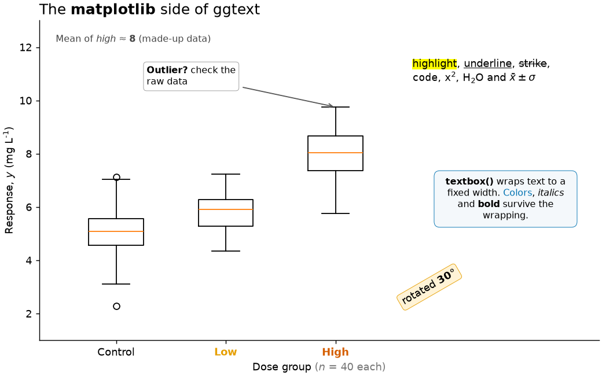

# matplotlib guide

ggtext doesn't need plotnine. Everything below works with plain matplotlib.

```python
import matplotlib.pyplot as plt
import ggtext
```



## Two kinds of arguments

Every helper takes:

1. **matplotlib text properties** (`fontsize`, `color`, `family`, `ha`, `va`, `rotation`, `alpha`, `transform`, `zorder`, `path_effects`, ...). These set the *default* style of the text, and the markup changes parts of it.
2. **rich text options**, the fields of `ggtext.RichTextSpec`:

| Option | Default | Meaning |
|---|---|---|
| `markdown` | `True` | interpret Markdown (HTML is always interpreted then) |
| `html` | `True` | interpret HTML when `markdown=False` |
| `math` | `True` | render `$...$` with mathtext |
| `newline` | `"break"` | `"break"` or `"space"` |
| `halign` | `None` | alignment of lines within the block; `None` uses `ma` |
| `valign` | `"top"` | text position in a box taller than the text |
| `width` | `None` | box width; text wraps to fit (fraction or units string) |
| `minwidth`, `maxwidth` | `None` | width limits. With a `width` they clamp it; with no `width`, `maxwidth` gives a shrink-to-fit box |
| `height` | `None` | box height (text that doesn't fit overflows, as in ggtext) |
| `minheight`, `maxheight` | `None` | height limits |
| `margin` | `0` | space outside the box (points; same forms as `padding`); moves the box away from the anchor |
| `padding` | `0` | space inside the box (points) |
| `fill` | `None` | box background |
| `box_color` | `None` | box outline |
| `linewidth` | `0.5` | outline width (points) |
| `linestyle` | `"solid"` | outline style |
| `r` | `0` | corner radius (points) |

ggtext sorts the arguments for you: `ggtext.text(ax, x, y, s, fontsize=12, fill="white")` works.

## Adding text

### `ggtext.text(target, x, y, s, **kwargs)`

Like `ax.text` (data coordinates) or `fig.text` (figure coordinates), with rich text:

```python
ggtext.text(ax, 2, 5, "peak at **t = 2**", ha="center", fontsize=11)
ggtext.text(ax, 0.02, 0.95, "<mark>note</mark>", transform=ax.transAxes, va="top")
ggtext.text(fig, 0.5, 0.01, "*Source:* made-up data", ha="center", fontsize=8)
```

It returns the `RichText` artist.

### Numeric alignment

Rich text also accepts numbers for `ha` and `va`, as ggplot2's `hjust`/`vjust` do: `ha=0.25` puts a quarter of the text to the left of the anchor, `va=0` is the bottom and `va=1` the top.

```python
ggtext.text(ax, 0.5, 0.5, "**quarter**", ha=0.25, va=0.5)
```

### `ggtext.textbox(target, x, y, s, width="2in", ...)`

A word-wrapped box, like ggtext's `geom_textbox`. The defaults are `fill="white"`, `box_color="black"`, `padding=5.5`, `r=5.5`, `linewidth=0.5`, and the box is centered on `(x, y)` (`ha="center"`, `va="center"`).

```python
ggtext.textbox(ax, 4, 6, "A **long** note that wraps to two inches.", width="2in")
ggtext.textbox(ax, 0.5, 0.5, "Half the axes wide", width=0.5, transform=ax.transAxes)
```

### `ggtext.annotate(ax, s, xy, xytext=None, **kwargs)`

`ax.annotate` with rich text. The arrow attaches to the edge of the rich text box:

```python
ggtext.annotate(ax, "**Outlier?**", xy=(3, 9.7), xytext=(1.2, 10.5),
                arrowprops=dict(arrowstyle="->"), fill="white", box_color="grey", padding=3)
```

## Titles and labels

```python
ggtext.set_title(ax, "**Bold** and *italic*", loc="left")
ggtext.set_xlabel(ax, "time, *t* (s)")
ggtext.set_ylabel(ax, "CO<sub>2</sub> (ppm)")
ggtext.set_suptitle(fig, "A <span style='color:#0072B2'>blue</span> figure title")
```

Each takes the same arguments as the matplotlib method, plus rich text options, and returns the text artist.

### Tick labels

```python
ax.set_xticks([1, 2, 3], ["Control", "**Low**", "<span style='color:#D55E00'>High</span>"])
ggtext.rich_ticklabels(ax, "x")           # "x", "y" or "both"; which="major"/"minor"/"both"
```

matplotlib creates new tick objects when the view changes (zooming, new limits). `rich_ticklabels` makes sure those new ticks are rich too.

## Making existing text rich

### `ggtext.richify(texts, **options)`

Converts one artist or a list of artists **in place**:

```python
ax.set_title("A plain title made **rich**")
ggtext.richify(ax.title)
ggtext.richify(ax.get_legend().get_texts())
```

### The `richtext` property

Importing ggtext adds a `richtext` property to every matplotlib `Text`, so you can turn rich text on anywhere that accepts text properties:

```python
ax.text(0.5, 0.5, "**bold**", richtext=True)
ax.set_title("**bold**", richtext={"fill": "#FFF8E1", "padding": 3})
text_artist.set(richtext=True)
plt.setp(ax.get_xticklabels(), richtext=True)
```

`richtext` accepts `True` (defaults), a dict of options, or a `RichTextSpec`. `False`/`None` leaves the text plain.

## `RichText` and friends

| Name | What it is |
|---|---|
| `ggtext.RichText(x, y, text, richtext=True, **text_kwargs)` | the artist; a subclass of `matplotlib.text.Text` |
| `ggtext.RichTextSpec(...)` | the options (an immutable dataclass); `.replace(**changes)` returns a modified copy |
| `ggtext.make_rich(text, richtext=True)` | convert one artist in place (what `richify` uses) |
| `ggtext.make_plain(text)` | undo it |
| `ggtext.is_rich(text)` | `True` if the artist renders rich text |
| `RichText.get_plain_text()` | the text with markup removed |
| `ggtext.parse(s)` | the parser: returns the styled runs, handy for debugging markup |
| `ggtext.register_image(name, array)` | make an array usable as `` |
| `ggtext.options` | `allow_remote_images`, `remote_timeout` |

```python
from ggtext import RichText
t = RichText(0.5, 0.5, "**hi**", transform=ax.transAxes, ha="center")
ax.add_artist(t)
```

## Works with the rest of matplotlib

- **Layout engines:** `layout="constrained"`, `layout="tight"`, `fig.tight_layout()`, and `savefig(bbox_inches="tight")` all measure rich text correctly, including rotated text and boxes.
- **Backends:** PNG (Agg), PDF, SVG, PS/EPS, and the interactive backends. Text stays text in PDF/SVG (searchable, with `svg.fonttype="none"`), and links are real hyperlinks.
- **Text properties:** `alpha`, `path_effects`, `backgroundcolor`, `bbox=dict(...)`, `zorder`, `clip_on`, `rasterized`, and `wrap=True` (wraps rich text at the figure edge, like plain text).
- **Pickling** a figure with rich text works.
- **Not supported:** `usetex=True`. The text is drawn as plain (TeX) text, with a warning.

## A note on fonts

Rich text uses matplotlib's font machinery, so any font matplotlib can find works in `font-family`. `font-family: monospace` and inline `code` use your `font.monospace` setting.
