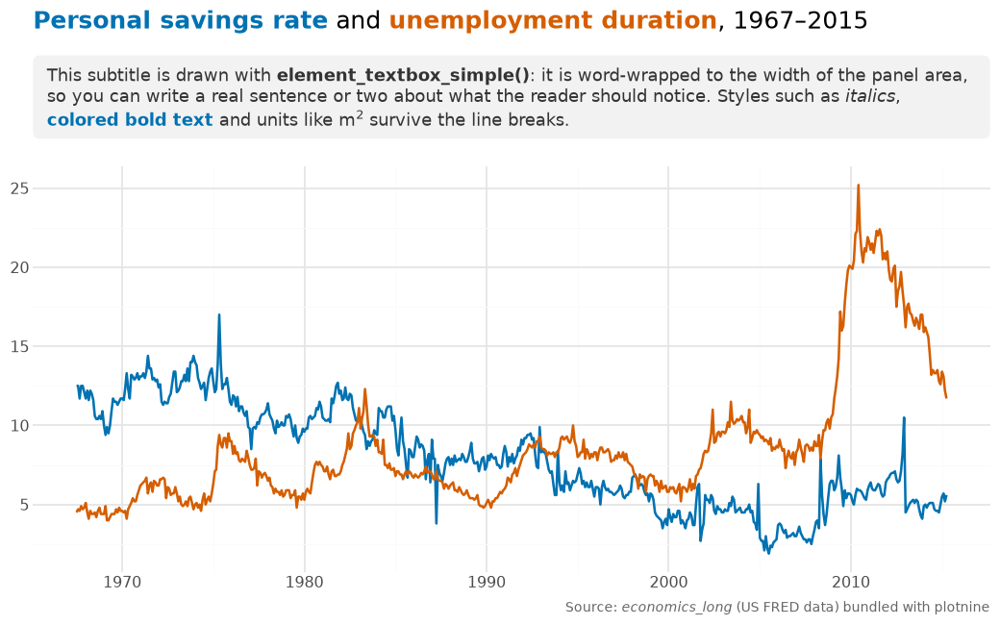
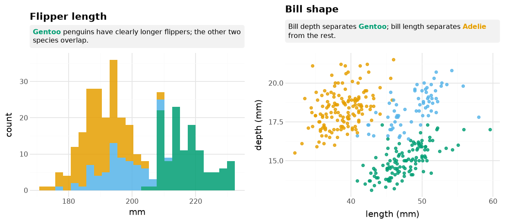
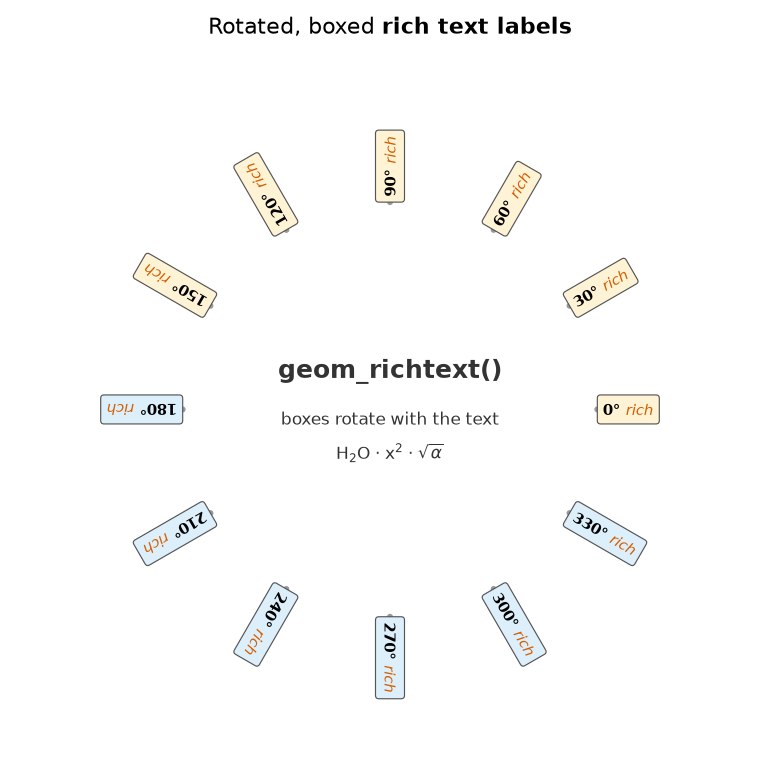
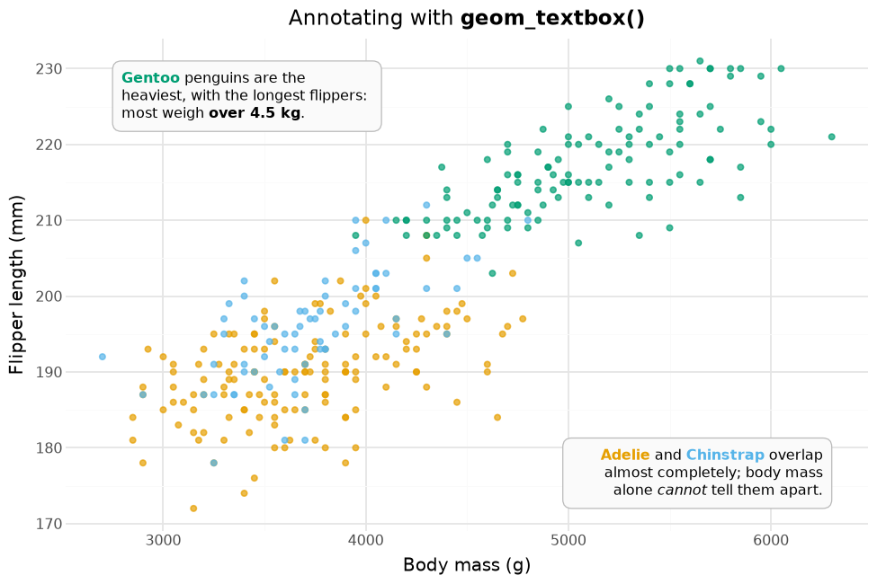

# plotnine guide

```python
from ggtext import (
    element_markdown,
    element_textbox,
    element_textbox_simple,  # theme elements
    geom_richtext,
    geom_textbox,  # geoms
)
```

(They also live in `ggtext.plotnine`.)

## Theme elements

### Which text can be rich?

**All of it.** The elements work with every text themeable:

| Themeable | Notes |
|---|---|
| `plot_title`, `plot_subtitle`, `plot_caption`, `plot_tag` | |
| `axis_title_x`, `axis_title_y`, `axis_title` | |
| `axis_text_x`, `axis_text_y`, `axis_text` | tick labels, at any `rotation` |
| `strip_text_x`, `strip_text_y`, `strip_text` | facet labels; combine with a labeller that returns markup |
| `legend_title`, `legend_text` | legend and colorbar text |
| `title`, `text` | the parent themeables: `theme(text=element_markdown())` makes *everything* rich |

Theme merging works as usual. `theme_bw() + theme(plot_title=element_markdown())` keeps theme_bw's title size and color and adds Markdown. A later `element_text()` for the same themeable keeps the Markdown, and `element_blank()` hides the text.

ggtext parses text only where you ask for it. A plot without ggtext elements renders as before: `labs(title="**x**")` alone still shows the asterisks.

### `element_markdown()`

A drop-in replacement for `element_text()`. It doesn't word-wrap.

```python
theme(
    plot_title=element_markdown(size=14),
    axis_text_x=element_markdown(rotation=45, ha="right"),
    plot_caption=element_markdown(fill="#FFF8E1", padding=3, r=2),
)
```

| Parameter | Default | Meaning |
|---|---|---|
| `fill` | `None` | background color of a box around the text |
| `box_color` | `None` | outline color of the box |
| `linewidth` | `0.5` | outline width (points) |
| `linestyle` | `"solid"` | outline style: `"dashed"`, `"dotted"`, ... |
| `r` | `0` | corner radius (points) |
| `padding` | `0` | space inside the box (points): a number, `(vertical, horizontal)`, `(t, r, b, l)`, or a dict with keys `t`, `r`, `b`, `l` |
| `halign` | `None` | alignment of the lines of multi-line text: `"left"`, `"center"`, `"right"`, or 0 / 0.5 / 1. `None` uses `ma` |
| `markdown` | `True` | interpret Markdown; if False, HTML only |
| `newline` | `"break"` | `"break"`: `\n` is a line break; `"space"`: Markdown behavior |
| `math` | `True` | render `$...$` as mathtext |
| `**kwargs` | | everything `element_text()` accepts: `size`, `color`, `family`, `weight`, `style`, `ha`, `va`, `ma`, `rotation`, `linespacing`, `margin`, ... |

The box draws only when you set `fill` or `box_color`. The box (including `padding`) is part of the text's size, so the layout makes room for it. `margin` stays outside the box, as in ggplot2.

### `element_textbox()`

Like `element_markdown()`, but the text can be **word-wrapped in a box of a given width**.

| Parameter | Default | Meaning |
|---|---|---|
| `width` | `None` | width of the box: a fraction in (0, 1] of the panel area, or a string with units (`"4in"`, `"300pt"`, `"10cm"`, `"80%"`). `None` fits the box to the text (no wrapping) |
| `height` | `None` | height of the box; same units. Text that doesn't fit overflows, as in ggtext. `None` fits the box to the text |
| `minwidth`, `maxwidth` | `None` | limits for the width. With a `width` they clamp it (as in ggtext). With `width=None`, `maxwidth` gives a shrink-to-fit box: short text gets a tight box, long text wraps at `maxwidth` |
| `minheight`, `maxheight` | `None` | limits for the height |
| `valign` | `"top"` | vertical position of the text in the box: `"top"`, `"center"`, `"bottom"` (or 1 / 0.5 / 0) |
| `orientation` | `None` | `"upright"` (0°), `"left-rotated"` (90°), `"right-rotated"` (270°), `"inverted"` (180°). Overrides `rotation` |
| `fill`, `box_color`, `linewidth`, `linestyle`, `r`, `padding`, `halign`, `markdown`, `newline`, `math` | | as in `element_markdown()` |

Unlike R's ggtext, you can set `rotation=` to give a text box **any** angle. `orientation` is a shortcut with ggtext's names.

```python
# A boxed y-axis title that spans 80% of the panel height
theme(
    axis_title_y=element_textbox(
        orientation="left-rotated",
        width=0.8,
        halign="center",
        fill="#E8EEF7",
        padding=4,
        r=3,
    )
)
```

### `element_textbox_simple()`

`element_textbox()` with defaults that suit long subtitles and captions: `width=1.0` (the full panel width), `halign="left"`, `valign="top"`, and `lineheight` 1.2. There's no box unless you set `fill` / `box_color`.

```python
theme(plot_subtitle=element_textbox_simple(size=10, margin={"b": 8}))
```



### Relative widths

ggtext measures a fractional `width` (or `maxwidth`, `height`) against:

| Text | Reference |
|---|---|
| plot title, subtitle, caption, tag, axis titles | the **panel area** of *that plot*: the box around its panels, not including the axis labels or legend |
| text drawn inside the panels (`geom_textbox(width=0.5)`) | the panel (axes) |
| rotated text (closer to vertical) | the panel *height*, so `width` always runs along the text |

In a **plot composition** (`p1 | p2`, `p1 / p2`), each plot's titles measure against that plot's own panels:



Behind the scenes, plotnine measures text *before* it moves the panels into place. A wrapped box can therefore have a different height once the panels have moved. So ggtext runs plotnine's layout a second time for figures that contain fractional-width text. You don't need to do anything. [design.md](design.md#two-pass-layout) has the details.

### ggplot2 spellings

ggtext accepts ggplot2 / R ggtext argument names as aliases, so ported code keeps working:

| R / ggplot2 | ggtext (Python) |
|---|---|
| `colour` | `color` |
| `face = "bold"`, `"italic"`, `"bold.italic"` | `weight=`, `style=` |
| `hjust`, `vjust` | `ha`, `va` |
| `angle` | `rotation` |
| `lineheight` | `linespacing` |
| `box.colour`, `box.color`, `box_colour` | `box_color` |
| `linetype` | `linestyle` |

In Python, pass names with dots through `**{...}`: `element_markdown(**{"box.colour": "grey"})`. We recommend the Python names for code you write now.

## Geoms

### `geom_richtext()`

Rich text labels in the data. By default each label sits in a white box with a thin outline. Unlike `geom_label()`, the box rotates with the text, at any angle.

```python
ggplot(df, aes("x", "y", label="label")) + geom_richtext(angle=30)
ggplot(df, aes("x", "y", label="label")) + geom_richtext(
    fill=None, label_size=0
)  # no box
ggplot(df, aes("x", "y", label="label", label_color="group")) + geom_richtext(
    hjust="inward"
)
```

The geoms follow ggtext's conventions:

- **Rotation around the anchor.** Labels rotate around their anchor point (`rotation_mode="anchor"`). So `ha="left"` means "the text starts at the point" at every angle. plotnine's `geom_text()` instead rotates first and then aligns the rotated bounding box; pass `rotation_mode="default"` for that behavior.
- **Justification.** `ha`/`va` (aliases `hjust`/`vjust`) accept names (`"left"`, `"center"`, `"right"`, `"bottom"`, `"top"`, `"middle"`, `"baseline"`) and numbers in [0, 1] (`hjust=0.25`). They also accept ggplot2's `"inward"`/`"outward"` (towards or away from the center of the panel).
- **Lines follow `ha`.** In a multi-line label, each line aligns like the label (`ha="right"` right-aligns them), as in gridtext. Set `halign` to override.
- **Mappable box and text colors.** `label_color`, `label_size`, and `text_color` are aesthetics, so they can vary with the data.

**Aesthetics:** `x`, `y`, `label` (required), `color`, `fill` (`"white"`), `alpha`, `size` (11), `angle`, `ha`/`hjust`, `va`/`vjust`, `family`, `fontweight`, `fontstyle`, `fontvariant`, `lineheight`, `group`. In addition:

| Aesthetic | Default | Meaning |
|---|---|---|
| `label_color` (`label_colour`) | `None` | outline color; `None` uses the text color, `"none"` draws no outline |
| `label_size` | `0.7` | outline width (points); `0` for no outline |
| `text_color` (`text_colour`) | `None` | text color; `None` uses `color` (which then colors text and outline) |

| Parameter | Default | Meaning |
|---|---|---|
| `label_padding` | `3.3` | space inside the box (points); also `(v, h)` or `(t, r, b, l)` |
| `label_margin` | `0` | space outside the box (points); moves the box away from the point |
| `label_r` | `2.0` | corner radius (points) |
| `halign` | `None` | alignment of the lines of multi-line labels; `None` follows `ha` |
| `rotation_mode` | `"anchor"` | `"anchor"` (ggtext) or `"default"` (plotnine's `geom_text`) |
| `markdown` | `True` | interpret Markdown |
| `newline` | `"break"` | `"break"` or `"space"` |
| `nudge_x`, `nudge_y`, `format_string`, `path_effects`, `adjust_text` | | as in `geom_text()` |

To draw labels with no box, set `fill=None` and `label_size=0` (R: `fill = NA, label.colour = NA`).



### `geom_textbox()`

Word-wrapped rich text in boxes of a fixed width. `ha`/`va` (or `hjust`/`vjust`, with the same values as in `geom_richtext()`) place the *box* relative to the point (default: centered). `halign`/`valign` align the *text* inside the box. Rotated boxes (`orientation`) turn around the anchor point, as in ggtext.

```python
ggplot(notes, aes("x", "y", label="label")) + geom_textbox(
    width="2.3in", fill="#FAFAFA"
)
```

**Aesthetics:** the text aesthetics of `geom_richtext()` plus `halign` (`"left"`), `valign` (`"top"`), and `orientation` (`"upright"`). Also `box_color`/`box_colour` (`None`: the text color; `"none"`: no outline), `box_size` (`0.7` points), and `text_color`.

| Parameter | Default | Meaning |
|---|---|---|
| `width` | `"2in"` | box width: units string or fraction of the panel width. `None` sizes each box to its text |
| `minwidth`, `maxwidth` | `None` | limits for the width. With a `width` they clamp it (as in ggtext); with `width=None`, `maxwidth` gives shrink-to-fit boxes |
| `height` | `None` | box height (text that doesn't fit overflows, as in ggtext); `None` fits the text |
| `minheight`, `maxheight` | `None` | limits for the height |
| `box_padding` | `5.5` | padding (points) |
| `box_margin` | `0` | space outside the box (points) |
| `box_r` | `5.5` | corner radius (points) |
| `rotation_mode` | `"anchor"` | how rotated boxes are placed; see `geom_richtext()` |
| `markdown`, `newline` | | as above |



## Translating from R ggtext

| R | Python |
|---|---|
| `library(ggtext)` | `from ggtext import element_markdown, element_textbox_simple, geom_richtext, geom_textbox` |
| `theme(plot.title = element_markdown())` | `theme(plot_title=element_markdown())` |
| `theme(axis.text.x = element_markdown(angle = 45, hjust = 1))` | `theme(axis_text_x=element_markdown(rotation=45, ha="right"))` |
| `element_markdown(fill = "cornsilk", box.colour = "grey", r = unit(4, "pt"), padding = unit(c(2, 4, 2, 4), "pt"))` | `element_markdown(fill="cornsilk", box_color="grey", r=4, padding=(2, 4, 2, 4))` |
| `element_textbox_simple(width = unit(1, "npc"))` | `element_textbox_simple(width=1.0)` (the default) |
| `element_textbox(width = unit(4, "in"), orientation = "left-rotated")` | `element_textbox(width="4in", orientation="left-rotated")` |
| `geom_richtext(aes(label = lab), fill = NA, label.color = NA)` | `geom_richtext(aes(label="lab"), fill=None, label_size=0)` |
| `geom_richtext(aes(label.colour = grp, label.size = w), hjust = "inward")` | `geom_richtext(aes(label_colour="grp", label_size="w"), hjust="inward")` (width in points) |
| `geom_textbox(width = unit(3, "in"), maxwidth = unit(2, "in"), box.margin = unit(4, "pt"))` | `geom_textbox(width="3in", maxwidth="2in", box_margin=4)` |
| `geom_richtext(label.padding = unit(0.25, "lines"), label.r = unit(0.15, "lines"))` | `geom_richtext(label_padding=3.3, label_r=2.0)` (points) |
| `geom_textbox(width = unit(2, "inch"), box.padding = unit(5.5, "pt"))` | `geom_textbox(width="2in", box_padding=5.5)` |
| `"line one<br>line two"` | same, or `"line one\nline two"` |
| `"a  \nb"` (two trailing spaces) | same; a plain `\n` also works |

Differences to keep in mind:

- **Newlines:** a plain `\n` is a line break by default. Use `newline="space"` for R's behavior.
- **Units:** sizes are points, not grid units. Widths are fractions or strings with units.
- **Image size:** an `` with no size is as tall as the font, not its natural pixel size.
- **Widths exclude margins:** `width`/`height` are the size of the box itself; `box_margin`/`label_margin` add space outside it. In ggtext the width includes the margins.
- **Outline widths:** `label_size`/`box_size` are in points (plotnine's convention), not mm. Multiply ggtext values by 72.27 / 25.4 ≈ 2.85.
- **Not yet ported:** `align_widths` / `align_heights`, `rotate_margins`. See the [roadmap](roadmap.md).

## More examples

- [Titles and subtitles](gallery.md#titles-and-subtitles)
- [Axis and tick labels](gallery.md#axis-and-tick-labels)
- [Facet strips and legends](gallery.md#facet-strips-and-legends)
- [Images in labels](gallery.md#images-in-labels)
