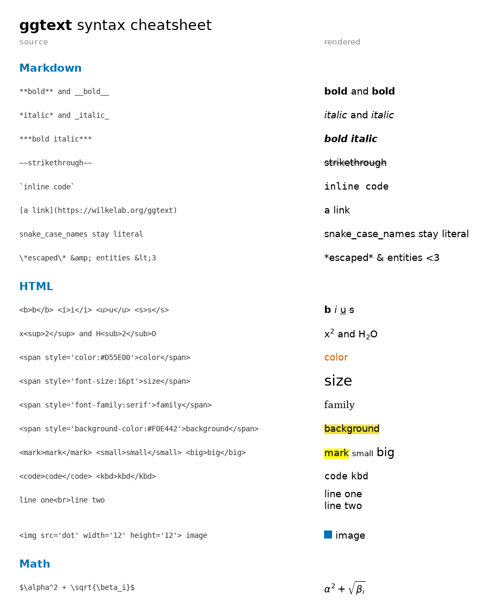

# Syntax reference

Everything on this page works the same way in every ggtext entry point. These are the plotnine theme elements and the geoms.



## Markdown

ggtext reads the *inline* part of [CommonMark](https://commonmark.org/), the Markdown standard, using [ggIR](https://github.com/snake-case-ggtext/ggIR) (built on `markdown-it-py`). Block syntax such as headings, lists, and quotes doesn't apply to plot labels and stays literal (`"1. first"` renders as `1. first`).

| You write | You get |
|---|---|
| `**bold**` or `__bold__` | **bold** |
| `*italic*` or `_italic_` | *italic* |
| `***bold italic***` | ***bold italic*** |
| `~~strikethrough~~` | ~~strikethrough~~ |
| `` `inline code` `` | `inline code` in a monospace font; the content is literal |
| `[text](https://example.org)` | the text, with a hyperlink in SVG and PDF output |
| `` | an inline image (see [Images](#images)) |
| `\*not italic\*` | \*not italic\* (backslash escapes) |
| `&amp; &lt; &gt; &bull;` | HTML entities: & < > • |

### snake_case is safe

CommonMark only treats `_` as emphasis at word boundaries, so column names render as written:

```
bill_length_mm      → bill_length_mm      (no italics)
x_1 and y_2         → x_1 and y_2
```

### The dunder gotcha

A name that *starts and ends* with underscores is valid emphasis, so `__init__` renders as bold "init". Wrap it in backticks or escape the underscores:

```
`__init__`          → __init__ in a monospace font
\_\_init\_\_        → __init__
```

## HTML

You can nest tags and combine them with Markdown (`<span style='color:red'>**bold red**</span>`). A tag that is never closed runs to the end of the text.

| Tag | Effect |
|---|---|
| `<b>`, `<strong>` | bold |
| `<i>`, `<em>` | italic |
| `<u>`, `<ins>` | underline |
| `<s>`, `<del>`, `<strike>` | strikethrough |
| `<sup>`, `<sub>` | superscript / subscript: 70% size, raised 0.4 em / lowered 0.2 em; they nest |
| `<br>` | line break |
| `<p>...</p>`, `<div>` | starts a new line (no extra blank line) |
| `<span style='...'>` | applies inline CSS |
| `<font color= face= size=>` | old-style color, family, size |
| `<code>`, `<kbd>`, `<tt>`, `<samp>` | monospace font |
| `<small>`, `<big>` | 83% / 120% size |
| `<mark>` | yellow highlight |
| `<a href='...'>` | hyperlink (SVG/PDF) |
| `` | inline image |
| `<!-- comment -->` | ignored |

**Every** tag accepts a `style` attribute, e.g. `<b style='color:#0072B2'>`.

An unknown tag triggers one warning; its text is still drawn. A closing tag with no matching opening tag also warns.

## CSS

Inside `style='...'`:

| Property | Values |
|---|---|
| `color` | any matplotlib color (`red`, `#D55E00`, `C1`, `tab:blue`), or `rgb(213, 94, 0)` / `rgba(...)` |
| `font-size` | `12pt`, `16px`, `1.5em`, `120%`, `larger`, `smaller`, `small` ... `xx-large` |
| `font-family` | a font name or generic family; lists work: `'Fira Sans', sans-serif` |
| `font-weight` | `normal`, `bold`, `light`, ... or `100`–`900` |
| `font-style` | `normal`, `italic`, `oblique` |
| `font-variant` | `normal`, `small-caps` |
| `background-color` (or `background`) | highlight behind the text |
| `text-decoration` | `underline`, `line-through`, `none` (can be combined) |
| `vertical-align` | `super`, `sub`, `baseline`, or a length such as `3pt` |

Unsupported properties trigger a single warning and are otherwise ignored.

> Relative sizes (`em`, `%`, `larger`, and keywords such as `large`) depend on the size of the *surrounding* text. That makes them predictable inside plots of any font size.

## Math

Segments between dollar signs go to matplotlib's [mathtext](https://matplotlib.org/stable/users/explain/text/mathtext.html):

```
"The $\alpha_1 \times \beta$ coefficient"
```

Math keeps the style around it (color, size). Inside `$...$`, Markdown has no effect, so `$a_1 * b_2$` is safe. A single `$` is just a dollar sign. Write `\$` for a literal dollar sign in a string that also contains math. Turn math off with `math=False`.

In Python source, use raw strings (`r"$\alpha$"`) or double the backslashes.

## Line breaks

| You write | Default (`newline="break"`) | `newline="space"` |
|---|---|---|
| `"a\nb"` | two lines | one line: `a b` |
| `"a<br>b"` | two lines | two lines |
| `"a  \nb"` (two trailing spaces) | two lines | two lines |

The default follows matplotlib and Python: `\n` starts a line. This differs from R's ggtext, where newlines are spaces as in Markdown. To get the Markdown behavior, pass `newline="space"` (to `element_markdown`, the geoms, or `RichTextSpec`).

## Images

```html

       <!-- bare numbers are CSS pixels (0.75 pt) -->

```

| `src` can be | Example |
|---|---|
| a local file | `logo.png`, `~/icons/x.png`, `file:///tmp/x.png` |
| a data URI | `data:image/png;base64,iVBORw0...` |
| a URL | `https://...`: downloaded once and cached. Disable with `ggtext.options.allow_remote_images = False`; set the timeout with `ggtext.options.remote_timeout` |
| a registered array | any name passed to `ggtext.register_image()` |

`register_image` lets you use numpy arrays or PIL images directly, with no files needed:

```python
import numpy as np, ggtext

ggtext.register_image("red_square", np.array([[[1.0, 0, 0]]]))
" means danger"
```

How ggtext sizes images:

- If you give only `width` or only `height`, the image's aspect ratio sets the other.
- If you give neither, the image is as tall as the font size, which suits axis labels and legends. R's ggtext uses the image's natural pixel size instead, which can easily overwhelm a plot.
- Images sit on the text baseline and can rotate in steps of 90°. At other angles, ggtext draws them upright and issues a warning.
- An image that fails to load triggers a warning and takes no space.

## Units

| Where | Unit |
|---|---|
| `font-size`, `padding`, `r`, `linewidth`, and image sizes | points (1/72 in), unless you write a unit |
| Length strings | `pt`, `px` (CSS px = 0.75 pt), `in`, `cm`, `mm`, `pc`, `em`, `%` |
| `width`, `height`, `maxwidth` of text boxes | a **fraction** in (0, 1] of the reference size, or a string with units: `"2in"`, `"150pt"`, `"5cm"`, `"50%"`, `"0.8npc"` |

The reference size for fractions is:

- the axes, for text inside an axes (including the geoms).
- the **panel area** (the box around all axes), for figure-level text such as plot titles.
- the figure, if there are no axes.

For text rotated closer to vertical than horizontal, `width` runs along the text. ggtext therefore measures `width` against the reference *height*.

A bare number greater than 1 is an error (`width=3` could mean inches, points, or pixels). Write `"3in"` or `"3pt"` instead.

## Turning parsing off

| Option | Effect |
|---|---|
| `markdown=False` | only HTML tags are interpreted |
| `markdown=False, html=False` (`RichTextSpec`) | the text is drawn literally (still as a `RichText`) |
| `math=False` | dollar signs are literal |
